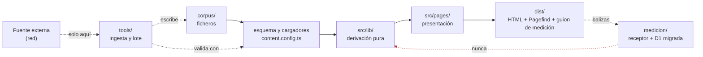
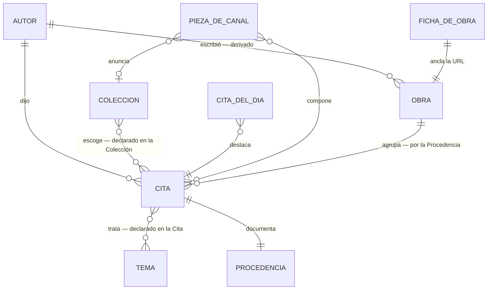
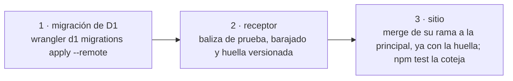

# Architecture Spine — Sabiduría de Bolsillo

## Design Paradigm

**Canalización de contenido en tiempo de build, con un plano de medición de un solo sentido.**

El Corpus es un conjunto de ficheros versionados que atraviesa una tubería de una sola dirección: *fuente → validación → derivación → prerenderizado*. No hay servidor de aplicación en el camino del visitante, ni base de datos que el sitio consulte, ni estado mutable del que dependa una página. El único almacén con escritura del que el sitio deriva algo es el repositorio git.

Junto a esa tubería corre un **segundo plano, y solo uno**: el receptor de la medición. Escribe y nunca se lee desde el sitio. Con el receptor caído, el sitio se construye y se sirve idéntico. Por eso no es una segunda fuente de verdad — es un desagüe, y AD-14 lo mantiene siéndolo.

*(v8)* El emisor de ese plano deja de ir en línea en cada página: es un fichero de guion que **el build genera desde `src/lib/medicion.ts`** (AD-6, AD-13), así que sigue derivando del repositorio y no del plano. Y el plano gana estado que evoluciona: el esquema de la tabla de D1 cambia solo por migraciones aditivas versionadas (AD-14); barajar sus filas no es migrarla (AD-13). El desagüe sigue sin devolver nada.

Las etapas se corresponden con espacios de nombres:

| Etapa | Vive en | Responsabilidad |
|---|---|---|
| Recuperación | `tools/` (capa exterior) | Descarga la Fuente y versiona su documento. **La única etapa con red.** |
| Fuente | `corpus/` | Citas, Autores, Temas, Colecciones y Fichas de Obra como ficheros. Verdad única. |
| Validación | `src/content.config.ts` | Esquema y cargadores de contenido. La puerta de admisión. *(v8)* También el cargador que localiza en `corpus/fuentes/` la posición de cada Cita y entrega solo esa posición (AD-23). |
| Derivación | `src/lib/` | Normalización, slugs, tramos, umbrales, agregaciones, orden de la Obra. Puro. |
| Presentación | `src/pages/`, `src/components/` | HTML, y *(v8)* el guion de medición que el build emite desde la derivación. Consume derivación; nunca lee `corpus/` directamente. |
| Composición del editor | `tools/` | Ingesta, auditoría y Piezas de Canal por lote. Comodidad, no puerta. |
| Capa pura compartida *(v8)* | `tools/lib/` | Lectura del corpus en crudo, cotejo, relación de cambios, indexables. La importan las integraciones del build, `astro.config.mjs`, el cargador de posiciones de `content.config.ts` y las órdenes; el criterio de la puerta del cotejo vive aquí. Sin red (AD-22). |
| Medición | `medicion/` | Recibe balizas. No devuelve nada al sitio. *(v8)* El esquema de su tabla cambia solo por migración aditiva. |



**Dirección de dependencias, invariante:** `corpus → esquema → lib → pages`. Ninguna flecha vuelve. La presentación nunca lee ficheros del corpus; la derivación nunca importa componentes; el corpus no conoce nada; **la medición no alimenta a nadie**. *(v8)* `tools/lib/` es la segunda capa pura: importa de `src/lib/`, la importan el build y las órdenes, y `src/lib/` nunca importa de ella. La red sigue solo en la cáscara de `tools/` (AD-22).

## Invariants & Rules

### AD-1 — La puerta de admisión vive en el esquema, no en la herramienta

- **Binds:** FR-13, FR-15, FR-27, todo `corpus/`, *(v8)* FR-55
- **Prevents:** que una Cita añadida a mano —sin pasar por `tools/`— se publique incumpliendo el criterio de admisión. Si la puerta estuviera en el script de ingesta, editar un fichero con el editor de texto la esquivaría. *(v8)* Y que un Autor publicado sin clave de orden caiga en una letra cualquiera del Directorio de Autores.
- **Rule:** el esquema de `content.config.ts` declara obligatorios `procedencia` en Cita y `añoFallecimiento` en Autor, y restringe `estadoDerechos` a `dominio-público`. Un fichero que los incumpla **rompe el build**. Ninguna comprobación de admisión puede vivir únicamente en `tools/`.
- **Enmendado en la v8 — una obligación de publicar, no de admitir.** La clave de orden del Autor (`ordenAlfabetico`, FR-15) es la primera:
  - **Su forma es puerta del esquema exportado**, como la forma de una edición (AD-20); la orden de `tools/autor.ts` la repite por comodidad. La forma exige que la clave dé, con la función hermana de AD-3, una inicial de la A a la Z o la Ñ: el Directorio no reparte letras imposibles.
  - **Su presencia se exige sobre los Autores publicados** (`autoresPublicados`, AD-11), no sobre toda ficha: un Autor con Citas publicadas y sin clave rompe el build con la ruta de su fichero; uno sin Citas publicadas, no.
  - **La revisión deja rastro y no bloquea.** `ordenRevisado` (jornada ISO) está presente solo cuando una persona confirmó o corrigió la clave, lo escribe la orden que la confirma y se omite si no. El build no lo lee; «sin revisar» se cuenta sin leer git. Que la clave no se escriba a mano es disciplina de `tools/`, como la `nota` de la Ficha de Obra, no una puerta.

### AD-2 — Lo no publicado vive fuera del árbol construido

- **Binds:** NFR-6, FR-1, FR-4, FR-6, FR-26
- **Prevents:** que contenido `en-revisión` se filtre al sitemap, a un listado o a un feed porque alguien olvidó aplicar un filtro. Un filtro es algo que se puede olvidar en cada lugar nuevo donde se consulte el Corpus.
- **Rule:** las Citas en revisión residen en `corpus/_revision/`, directorio que la colección **no carga**. No existe un campo `publicada` que filtrar en tiempo de ejecución. Publicar es mover el fichero. La ausencia es estructural, no condicional.

### AD-3 — Una sola normalización canónica de texto

- **Binds:** FR-7, FR-8, FR-14, *(v8)* FR-9, FR-55
- **Prevents:** que la búsqueda considere iguales «café» y «cafe» mientras la detección de duplicados los considere distintos, o al revés. Dos caminos, dos criterios, resultados incoherentes que solo aparecen en producción. *(v8)* Y una segunda normalización encubierta: la canónica pliega la Ñ en N, y el Directorio la trata como letra propia.
- **Rule:** `src/lib/normalizar.ts` exporta una única función que quita diacríticos, pasa a minúsculas, colapsa espacios y elimina puntuación. Búsqueda, detección de duplicados y generación de slugs la consumen. Ningún módulo implementa su propia normalización.
- **Enmendado en la v8 — dos consumidores más, con el mismo dueño.**
  - **El filtro de los Directorios es el tercer consumidor** de la función canónica, y casa por subcadena de lo normalizado. Corre en el cliente y la importa por un guion empaquetado (AD-6); nunca la reimplementa.
  - **La inicial y el orden del Directorio** salen de una función hermana en el mismo módulo: inicial sin tilde con la Ñ como letra propia, y clave de comparación de la clave de orden, con el slug del Autor como desempate. El Directorio de Autores, las letras de salto de los dos Directorios y los destacados de FR-8 la consumen; ningún módulo ordena Autores por su cuenta.
  - **Dos órdenes de Autores que se enseñan, los dos de este módulo.** El mismo módulo da también el orden por el nombre tal como se lee, con la comparación canónica, que consume el selector de Autor de `/buscar/` porque su búsqueda por tecleo casa por el principio del rótulo; y el de los Temas, por su nombre con el artículo. La regla vincula los órdenes que se enseñan: la rotación de la Cita del Día sigue por slug como **excepción declarada**, porque migrarla cambiaría la permutación de las aptas el día del despliegue y repetiría Citas antes de agotarlas (FR-9).

### AD-4 — El slug de una Cita es inmutable y no deriva de su agregación

- **Binds:** FR-1, FR-6, FR-26, FR-28, NFR-4
- **Prevents:** que reasignar una Cita a otro Tema —o meterla en una Colección— cambie su URL, exactamente lo que FR-1 prohíbe, y que dos builders deriven la URL de forma distinta rompiendo enlaces entrantes.
- **Rule:** el slug se deriva de `slug-del-autor` + fragmento normalizado del texto, se escribe en el fichero al crearlo y **no se recalcula nunca**. Ni los Temas ni las Colecciones participan en ninguna ruta de Cita.

### AD-5 — La derivación es pura y no conoce la presentación

- **Binds:** todo `src/lib/`
- **Prevents:** que la lógica de agregación, umbrales y tramos quede atrapada dentro de componentes y se duplique con variantes al aparecer la segunda superficie que la necesita.
- **Rule:** los módulos de `src/lib/` son funciones puras sobre datos ya validados. No importan componentes, no leen el sistema de ficheros, no dependen de Astro — `astro:content` entra solo como `import type`, que TypeScript borra al compilar. Son verificables sin renderizar nada.

### AD-6 — Cero JavaScript por defecto; toda isla es declarada y contada

- **Binds:** NFR-2, NFR-7, FR-10, FR-7, FR-17, FR-18, FR-37, *(v8)* FR-3, FR-9, FR-51, FR-55, FR-56
- **Prevents:** que el contenido principal acabe dependiendo de la ejecución de JavaScript, que es lo que sostiene todo el mecanismo de crecimiento del producto, y que el peso del guion crezca por acumulación sin que nadie lo decida. *(v8)* Y sus dos salidas falsas: un tope que se sube en cada épica a la que estorba, y un vocabulario de medición copiado en `public/` para escapar del tope.
- **Rule:** las páginas no envían JavaScript salvo por una isla declarada, hidratada bajo demanda *(v8: salvo los guiones de la lista cerrada que se cargan con la página, abajo)*. El texto de toda Cita, Autor, Tema, Colección, *(v8)* Obra y Directorio está en el HTML inicial sin excepción; el filtro de los Directorios se añade sobre la lista entera. `MAX_BYTES_DE_GUION` en `src/lib/umbrales.ts` es el tope de guion en línea de *(v8)* **toda superficie pública**, medido en cada una —no solo en la Página de Cita—, y las pruebas parten de él: **subirlo es una decisión visible en un diff, y se sube cuando entra una isla a propósito, nunca porque algo engordó por su cuenta**. El `application/ld+json` de los datos estructurados no cuenta: no es JavaScript ejecutable.
- **Ratificado en la v3:** las islas son cuatro, no tres. Tres públicas —Imagen de Cita, copiar y compartir enlace— y una interna, la Imagen del Kit. El número no es la invariante; el ser declarada y contada sí. Para lo que traiga un Modelo de Ingreso, manda AD-20.
- **Enmendado en la v8 — la medición sale a un fichero, y los guiones externos son una lista cerrada** *(Héctor, 2026-10-18)*:
  - **El guion de medición es un `<script src defer>` que genera el build desde `src/lib/medicion.ts`**, por un endpoint `.js.ts` cuyo `getStaticPaths` queda vacío sin `MEDICION_ENDPOINT`: sin punto final no hay fichero ni etiqueta, pero el marcado del build —el `data-*` de las vistas, las zonas y la marca indexable— se queda en `dist/` *(v8.2)*. Su URL se versiona por su contenido. **Se carga en toda superficie pública con vista, zona o búsqueda** —también `/buscar/`, las páginas 2+, el 404 y la página 1 de una Obra que no se indexa—, no solo donde hay vista. Las vistas las emite el fichero a partir de un `data-*` de la página que declara **el conjunto** de vistas de esa página —la página 1 de una Obra indexable emite dos— y que deriva de `superficies.ts` (AD-17); sin ese `data-*`, no emite ninguna. Las islas emiten por la cola de `__medir` que abre el armazón (AD-13), así que el fichero puede llegar después.
  - **Pérdida nombrada.** GitHub Pages sirve con `max-age=600` y cada despliegue sustituye el sitio entero: tras un despliegue que cambia el guion, un HTML en caché apunta hasta 10 minutos a un fichero que ya no existe, y esas vistas se pierden. Solo ocurre cuando cambia el vocabulario (Deferred).
  - **Lista cerrada de guiones externos, cada uno con su tope con nombre en `umbrales.ts`.** La lista nombra **entradas**, no ficheros. Se cargan con la página el de medición y los **guiones empaquetados por Astro** de las islas que necesitan `src/lib` —el filtro de los Directorios y la búsqueda con filtros—, que insertan su control al cargar e importan `normalizar`, `tipoDeResultado`, `umbrales` y el vocabulario de la medición sin copiarlos (AD-3, AD-9, AD-13). Se piden con `import()` al usarlos `public/islas/imagen.js`, al pulsar —salvo en el Kit y el Lote, superficies internas, que lo importan al cargar—, y el guion de Pagefind, al enfocar el campo, al elegir un filtro o al llegar con estado en la dirección. `public/islas/` queda solo para lo que se pide con `import()`. **El tope de cada entrada cuenta todo lo que importa de forma estática**, trozos compartidos incluidos: en una entrada que se carga con la página, medido como los bytes que descarga al cargar en cada página que la lleva; en una que se pide con `import()`, como su fichero con todo lo que importa de forma estática, se pida cuando se pida. `bytesDeGuionEnLinea` cuenta cero a un `<script src>`, así que un guion externo fuera de la lista o sin su tope es un fallo de prueba, no un ahorro.
  - **Un guion empaquetado es siempre externo, por configuración.** Astro mete en línea todo guion procesado sin importaciones que pese menos que `vite.build.assetsInlineLimit` —4 KB por omisión; comprobado en la 7.2.0, se reverifica al subir Astro—, así que el plano de un guion dependería de su tamaño y del de sus vecinos. `astro.config.mjs` fija ese límite como función que devuelve `false` para los `.js` y deja lo demás a la regla por omisión, y una prueba sobre `dist/` exige que ningún guion procesado quede en línea.
  - **El presupuesto en línea.** Sacar la medición libera unos 680 bytes por página. Los disparadores de la Historia y de «Más opciones…» entran en ese hueco o suben el tope en el mismo diff que los trae, como isla que entra a propósito. **Ningún guion en línea lleva datos de contenido** —slug, texto, Obra—: van en `data-*`, para que el peso en línea sea constante por familia —salvo el guion de la isla de Imagen, que falta donde la Cita no la admite— y el tope no dependa de la jornada (AD-12). Es una migración: hoy `CopiarCita.astro` mete el slug por `define:vars`.
  - **Una prueba de ausencia no prueba nada.** Las pruebas que afirmaban la medición en línea, o que «la página no descarga ningún fichero de script», se juzgan contra la lista cerrada y contra el fichero construido con punto final; el criterio de la Historia 2.1 se reescribe en ese sentido.
  - **`/buscar/` sin guion:** el aviso de que buscar y filtrar lo necesitan va en `<noscript>`, y el mismo componente, dentro de un `<template>`, para cuando el índice no carga; el campo y los selectores los inserta la isla. **Con el guion activo y el paquete caído también hay salida**: la página no depende de que el paquete ejecute para enseñar el aviso o un campo que funcione —el aviso en el HTML inicial, que la isla retira al arrancar, o el campo como formulario GET a `/buscar/`, como el de la portada—. El medio lo elige el código; un `h1` solo, nunca.
  - **Las islas de la v8**, declaradas y contadas: copiar, Imagen y compartir sobre la Cita del Día de la portada; compartir en la página 1 de la Página de Obra, su primera isla; el disparador de la Historia de Instagram; el botón que sustituye al `<details>` de «Más opciones…» donde hay hoja; el filtro de los Directorios; la búsqueda con filtros; el guion de medición y su arranque en línea en el armazón (AD-13); y el 9:16 de la Imagen del Kit.

### AD-7 — La Imagen de Cita se compone en el cliente

- **Binds:** FR-10, FR-11, *(v8)* FR-17, FR-18, FR-21
- **Prevents:** las dos alternativas caras — pregenerar una imagen por Cita en el build (peso y tiempo insostenibles para algo que casi nadie pide) o servirlas desde una función en servidor (rompe el despliegue puramente estático e introduce coste e infraestructura).
- **Rule:** el generador dibuja sobre canvas en el navegador, dentro de la isla, usando las mismas fuentes y tokens que la página. La descarga se produce en el cliente.
- **Ratificado en la v3:** la Tarjeta Social de FR-19 **sí** se pregenera por Cita en el build, y no es una excepción a esto: es AD-15 aplicado a un consumidor distinto. La regla general de qué se compone dónde vive en AD-15; AD-7 queda como el caso concreto de la Imagen de Cita.
- **Precisado en la v8 — dos formatos, una sola ruta de generación.** El cuadrado y el 9:16, los dos con el dominio al pie, salen del mismo generador del cliente, también el 9:16 del Kit. El dominio llega a `imagen.js` desde `dominio.ts` por `data-*`. Entre el toque que comparte la historia y `navigator.share({ files })` no hay ninguna espera de red ni de composición: el primer toque carga `imagen.js`, compone y previsualiza; el segundo copia el enlace marcado y comparte *(ADOPTADO, v8.1)*.
  - **El segundo toque.** `writeText` se lanza antes de `share()`, en el mismo manejador y el mismo turno, y las dos se esperan después: `share()` consume la activación. «Enlace copiado» se dice solo si `writeText` resolvió, y depende solo de esa promesa *(v8.2)*: **nada de la interfaz espera a `share()`**, que en Chrome para Android puede no resolverse nunca —Chromium se salta allí la comprobación de compartición en curso porque la plataforma no siempre avisa al terminar—. La compartición se emite al resolver `share()`, porque se cuenta lo que ocurrió (FR-20); donde la promesa no resuelve no se cuenta, y **SM-7 y SM-12 son cota inferior en Chrome para Android** *(Héctor, 2026-10-20)*: lo es la cuenta de comparticiones, que en SM-12 es el denominador, así que su cociente puede quedar por encima.
  - **Cada rechazo de `share()` tiene conducta.** Tres caen en la descarga, y ninguno más *(v8.2)*: `NotAllowedError`, `DataError` y `TypeError`; `InvalidStateError` —otra compartición en curso— se ignora; `AbortError` no registra nada, a sabiendas de que cubre también «no hay destinos» y el fallo de entrega tras abrir la hoja.
  - **La descarga impuesta lleva el destino del botón** *(v8.2, Héctor, 2026-10-20)*: `opaco` en la Imagen cuadrada, `instagram-historia` en la Historia. No la eligió el visitante, sino el navegador al rechazar: no gasta la `primera` de SM-5, y SM-12 no suma la de `opaco`, que no deja enlace (AD-13). La que el visitante elige va sin destino.
  - **La caída a la descarga es solo para lo que el navegador rechaza antes de abrir la hoja** *(v8.2, Héctor, 2026-10-20)*. Un fallo de entrega tras abrirla llega como `AbortError`, como cancelar, y no descarga; en la Historia queda el enlace copiado. `DataError` no lo emite ningún motor: se conserva por la especificación, pero Chromium y WebKit entregan el fallo de transmisión —y WebKit, el de leer los ficheros— como `AbortError`, y el mensaje no es interoperable, así que nada distingue ese fallo de cancelar. La matriz de la 25.3 provoca ese caso.
  - **La URL marcada se compone en el build**, con el mismo dueño que los destinos de enlace (`compartir.ts`), y llega a la isla por `data-*`, también la de `opaco` y la de `instagram-historia`. Nunca se deriva de `location`, que en la portada es `/`.
  - **El destino Historia está sin confirmar** en iOS. Antes de que se construya el 9:16, la matriz de dispositivos comprueba la Historia en iOS Safari y en Android Chrome con la versión de Instagram del día. Si en iOS no está, el cuadrado se conserva, porque va por la misma vía. **No hay destino Feed** en el conjunto cerrado *(v8.2)*: qué hace en iOS el botón de la Historia lo decide Héctor en la 25.3, con la matriz delante, y solo entonces entra en el vocabulario (AD-13).

### AD-8 — Una sola definición de los tramos tipográficos

- **Binds:** FR-10, FR-19, FR-21, FR-30, `DESIGN.md`, `EXPERIENCE.md § Tipografía adaptativa`, *(v8)* FR-17
- **Prevents:** que la Página de Cita, el generador de imagen, la Tarjeta Social y las Piezas de Canal calculen el tramo por separado y unos mientan respecto a otros.
- **Rule:** `src/lib/tramos.ts` es la única fuente de la tabla de tramos por longitud, incluido el corte que oculta la acción. Toda superficie que componga texto de Cita la consume. Nadie codifica un tamaño de Cita a mano.
- **Precisado en la v8 — la columna 9:16.** Es una columna más de la misma tabla y llega a `imagen.js` por `data-*`, como `data-tamano`. La geometría del lienzo 9:16 —bandas de la historia y pie— se declara una sola vez, junto a la del cuadrado en el generador, y una prueba la fija contra ella. La prueba de los tramos corre con el pie de dominio puesto, en los dos formatos: una Cita de hasta `MAX_CARACTERES_IMAGEN` que deje de caber no se encoge (NFR-12).
  - **La prueba de cabida corre en el navegador**, porque cabe o no lo decide `measureText` con Source Serif cargada, y `lienzo.ts` rasteriza con las fuentes del sistema: es Playwright local (Entorno operativo), sobre las Citas publicadas más largas de cada tramo y en los dos formatos. En el navegador, **una Cita que no cabe no se compone**: el generador da su mensaje de fallo, que ofrece copiar el texto, y nunca encoge ni recorta.
  - **La Historia se ata al corte de la acción.** La isla de compartir ofrece «Historia de Instagram» solo si un `data-*` derivado de `tramos.ts` dice que la Cita admite Imagen, no por la sola capacidad del navegador. En la Página de Obra ese `data-*` no existe, y la Historia tampoco.

### AD-9 — Los umbrales son configuración con nombre

- **Binds:** FR-5, FR-6, FR-10, FR-26, FR-33, SM-C2, *(v8)* FR-7, FR-9, FR-12, FR-56
- **Prevents:** que un umbral viva como literal en tres sitios y una revisión futura cambie dos de ellos.
- **Rule:** `src/lib/umbrales.ts` es el único sitio donde aparece un literal numérico de regla de negocio, y también una fecha que una regla o un informe nombra. *(Reescrito en la v8 como regla: la lista de la v1 ya no era el inventario, y no se mantiene aquí.)* Los Umbrales de Activación de los Modelos de Ingreso entran ahí y en ningún otro sitio.
- **Precisado en la v8.** Entran ahí, entre otros: el tiempo mínimo de la lectura (8 s), el tope de cada guion externo (AD-6), el mínimo de lecturas que cierra una línea base, la tanda de resultados, los recuentos de «De la misma obra», de las Obras y de los Autores destacados de la portada, las pausas de tecleo que comparten el filtro de los Directorios y `/buscar/`, y las fechas que nombra la línea SM-11, junto a `PRIMER_DESPLIEGUE_DE_OBRAS`, y los cortes de serie (AD-13); y el aviso y el tope del peso de `dist/` (Entorno operativo), el tope del número de PNG (AD-16) y los tamaños que reabren un aplazado —los filtros de Pagefind con el mapa de rótulos y el HTML de `/obras/`—, que el build avisa al pasar, sin romper. **El peso de `dist/` y el tamaño de los filtros y del mapa de rótulos se miden en un paso final de `npm run build`, después de Pagefind**, sobre lo que se despliega —`dist/pagefind/` incluido—, nunca en `astro:build:done` *(v8.2)*. **Su veredicto no depende de la jornada** (AD-12): se calcula sobre `dist/` sin los ficheros que rotan con ella —la portada, el 404, `/kit`, `/lote` y `rss.xml`—, que se miden y se informan aparte; la función pura que lo da recibe la medida ya sin ellos, y una prueba lo fija. La línea de cifras del parte no es un aviso: avisa solo lo que cruza un umbral. Un guion empaquetado los importa; uno de `public/islas/` los recibe por `data-*`, nunca copiados. Los cortes de los tramos de `busqueda` no entran: son vocabulario de la medición (AD-13).
- **Las jornadas de despliegue** *(v8.2)*. Tienen la forma que ya usa el código: una cadena de jornada por despliegue, `undefined` mientras no llega —`DESPLIEGUE_DE_LA_REPARACION`, `DESPLIEGUE_DE_OBRA_Y_DIRECTORIOS`, `DESPLIEGUE_DE_LA_PORTADA_DE_RETORNO`—. Cada una es la jornada **UTC** en que termina el trabajo «Desplegar» de Actions que la lleva al sitio en vivo, nunca la del merge ni la del reloj de quien la anota, y lo que la compara en `tools/` pasa su «hoy» a UTC antes de comparar. Una fecha que nombran dos reglas es una sola constante: los cortes de serie se componen de estas, nunca de un literal (AD-13).
  - **Ganan tres** *(v8.2, Héctor, 2026-10-23)*, con la misma forma: la llegada en vivo de la Épica 25 y la de la 27, cada una con la suya, y la de la 28 también si llega tras el juicio de SM-11, en la misma `DESPLIEGUE_DE_LA_PORTADA_DE_RETORNO` que la anota si llega antes: un despliegue, una constante. Así cada épica de la v8 tiene la jornada de su llegada en vivo.
- **Las pasadas de prueba que escriben en el D1 de producción** *(v8.2, Héctor, 2026-10-23)* son otra constante con nombre: una entrada por pasada —la 25.3 y la 25.7, las únicas (Entorno operativo)— con su jornada UTC y las rutas que recorrió, vacía hasta la primera. La anota Héctor el día de la pasada, `DESPLIEGUE.md` la cita y no la copia, y la orden de la línea base (AD-14) descuenta los registros de esas rutas en esas jornadas.

### AD-10 — El Corpus no tiene otro almacén que git *(ADOPTADO — elección de Héctor)*

- **Binds:** FR-13…FR-16, FR-27, UJ-4, todo el despliegue
- **Prevents:** la deriva hacia un segundo origen de verdad. Con base de datos y ficheros conviviendo, la pregunta «¿cuál manda?» aparece en la primera incidencia.
- **Rule:** no hay base de datos, ni CMS, ni panel autenticado del que el sitio derive contenido. La ingesta escribe ficheros; la auditoría los lee. La historia editorial es la historia de git. El almacén de la medición no es una excepción: no contiene contenido y el sitio no lo lee (AD-14).

### AD-11 — El conjunto publicable tiene un solo dueño

- **Binds:** FR-1, FR-4, FR-6, FR-12, FR-26, FR-51, FR-52, NFR-1, NFR-5, NFR-6, *(v8)* FR-7, FR-8, FR-9, FR-55
- **Prevents:** la divergencia que AD-9 **no** cierra. Que el umbral sea una constante con nombre no dice *quién lo aplica*: quien genera las rutas de Tema y quien genera el sitemap pueden leer el mismo `MIN_CITAS_POR_TEMA` y aun así discrepar sobre un Tema de 14 Citas — página sin sitemap, o chip que enlaza a un 404. *(v8)* Y que NFR-5 deje de cumplirse sin que nada falle: sin la lista de Autores en la portada, una Cita queda a tres saltos solo mientras tenga un Tema publicado.
- **Rule:** `src/lib/publicado.ts` expone las funciones que devuelven el conjunto de Citas, Autores, Temas **y Colecciones** publicables. **Toda** superficie que enumere contenido —rutas, sitemap, índice de Pagefind, chips, listados, descubrimiento, Tarjetas Sociales, Piezas de Canal— deriva de ellas. Ningún módulo aplica un umbral por su cuenta ni filtra colecciones directamente.
- **Extendido en la v3 — publicable y alcanzable son el mismo conjunto.** AD-11 fijaba *qué se publica* y nadie fijaba *qué se enlaza*, que son dos preguntas distintas: una Colección podía quedar publicada, en el sitemap y **huérfana**, incumpliendo NFR-5 y FR-26 sin que fallara nada. El mismo módulo posee ahora la enumeración de descubrimiento, de modo que una superficie no puede ser publicable y no ser alcanzable desde la portada. El agujero solo aparece al existir un tipo nuevo de agregación — por eso la v1 no lo vio.
- **Extendido en la v7.1 — la Obra.** El conjunto publicable incluye las Obras con Citas publicadas —todas existen y todas son alcanzables— y es dueño de la regla que decide cuáles se indexan (AD-17, AD-25). `rutasPublicadas` **sigue significando «existe y es alcanzable»** (NFR-5) y enumera todas las rutas de Obra. El mismo módulo expone **`rutasIndexables`**, y todo consumidor que anuncia o mide la usa: el rastreo, el informe de AD-24, el aviso de AD-27 y la prueba del sitemap. Indexable es un subconjunto de publicable con el mismo dueño, nunca un segundo conjunto con otro.
- **Extendido en la v8 — lo que enumeran la portada, la búsqueda y los Directorios.**
  - **Más enumeraciones con el mismo dueño:** los Directorios (`autoresPublicados`, `obrasPublicadas`); las opciones de filtro de `/buscar/` y el `data-pagefind-filter` de cada Cita, de **una sola función** que compone las dos cosas; los ocho Autores destacados, de **una sola función** para la portada y la búsqueda sin resultados, que implementa la regla de FR-8 tal como FR-8 la dice y reutiliza el predicado «cuenta para el suelo», cuyo dueño es `src/lib/huecos.ts`, no `salud` *(v8.2)*; las seis Obras de la portada (AD-12); la línea de cifras, contada con `esCitaDocumentada`, y su coletilla «cada una con su fuente», que la misma función escribe solo con el censo de pendientes de cotejo vacío; y los recuentos de la Tarjeta de Obra y de las rutas de salida.
  - **El mapa de rótulos de la búsqueda** —nombre de ficha → título y Autor— lo genera el build desde la misma función como un JSON que la isla pide junto a `filters()`, nunca en el HTML. El Autor de una dirección con `obra` y sin `autor` sale de ese mapa, nunca de partir el nombre en el cliente.
  - **Lectores de `rutasIndexables`, también:** los resultados de Pagefind, las Obras de la portada y la marca de `vista-de-obra`. **Dos lectores usan, a propósito, el conjunto publicable y no el indexable:** el filtro de Obra, que ofrece toda Obra con Citas publicadas, y el Directorio de Obras, que las enlaza todas (FR-52).
  - **Los filtros, los metadatos y la clave de orden de una Cita los escribe un solo componente, y solo en su Página de Cita**, fuera de todo bloque reutilizable. Pagefind recoge `data-pagefind-filter` y `data-pagefind-meta` también dentro de un `data-pagefind-ignore` sin valor, así que todo bloque que enumera Citas, la Tarjeta de Obra y el bloque de la Cita del Día llevan `data-pagefind-ignore="all"` (AD-19). Una prueba sobre `dist/` exige que todo registro con filtro `autor` sea una Página de Cita, con exactamente un valor en `autor` y como mucho uno en `obra`, los suyos, y en `tema` exactamente sus Temas publicados, y que los recuentos de `filters()` coincidan con los de este módulo.
  - **El «Siguiente» de una Obra de una sola Cita** lleva a la primera Cita del **siguiente Autor** en el listado del primer Tema **publicado** de la Cita —el primero en el orden en que la Cita los declara—, nunca a otra del mismo Autor; tras el último Autor, al primero; sin Tema publicado, o sin otro Autor en él, no hay «Siguiente». Lee ese orden del mismo dueño que pinta la Página de Tema. «De la misma obra» y «Más de {Autor}» dejan fuera la Cita que se lee y la siguiente, y «Más de {Autor}», también las de su Obra; sus cuatro las elige una función determinista del commit, nunca de la jornada (AD-12).
  - **NFR-5 se comprueba en el build** *(Héctor, 2026-10-18)*. En `astro:build:done`, sobre el grafo de enlaces del `dist/` real, `superficiesInalcanzables` rompe el build si una superficie publicable queda a más de `MAX_SALTOS_DESDE_LA_PORTADA` saltos. La frase de la v3 —«una superficie no puede ser publicable y no ser alcanzable»— pasa a tener puerta. Tres precisiones:
    - **el grafo se calcula sin los bloques que rotan con la jornada** —la Cita del Día con su Tarjeta de Obra y sus acciones, y las seis Obras—, reconocidos por su marca `data-jornada`, para que el veredicto no dependa del día (AD-12); y solo cuenta un enlace que está en el HTML con guion y sin él, así que ignora `<template>` y `<noscript>`;
    - **las órdenes que retiran** —`documentar --retirar`, `autor retirar`, `coleccion quitar`, *(v8.2)* `coleccion despublicar` y `tema quitar`— se niegan con código 1 si dejarían una Cita a más de esos saltos, y la nombran. Calculan los saltos con `superficiesInalcanzables` sobre el **grafo del modelo** que compone una sola función de `publicado.ts`, con cada arista sacada de la enumeración que la pinta en la página, nunca de una lista aparte *(v8.2)*: portada → Temas, Colecciones y Directorios; cabecera; Tema → página N → Cita, y así cada listado con todos sus números de página; Autor → sus Obras y sus Citas; Directorios → Autores y Obras. El build comprueba en `astro:build:done` que el grafo del `dist/` real contiene ese grafo. Es lo que mantiene cierto que retirar una Cita no tumba el sitio (AD-18, AD-25) cuando un Tema cae bajo su umbral;
    - **el build sigue rompiendo como última red**, nombrando la superficie y, si la causa es un Tema que cayó bajo su umbral, ese Tema. `revisar` y, *(v8.2)*, `tools/alta.ts` se niegan, por comodidad, a publicar una Cita sin Tema **publicado**.

### AD-12 — La jornada de la Cita del Día la fija el build, no el visitante

- **Binds:** FR-9, FR-29, NFR-2, *(v8)* FR-12, NFR-5
- **Prevents:** la tensión real entre «cambia una vez por jornada» y un sitio prerenderizado. Sin decisión, un builder resuelve la fecha en el cliente (y mete JavaScript en la portada, contra AD-6), otro la congela en el build, y un tercero reconstruye a cada push (y la Cita del Día cambia tres veces en una tarde, contra FR-9). *(v8)* Y que la reconstrucción diaria rompa sin que nadie haya commiteado nada, porque un veredicto del build se calculó sobre lo que rota.
- **Rule:** la selección es determinista a partir de la **fecha** del build —no del instante—, sobre el subconjunto apto para portada. El CI reconstruye una vez al día a hora fija, además de en cada push. Una fijación manual en `corpus/portada.json` para esa jornada tiene prioridad sobre la rotación.
- **Ratificado en la v3:** las fijaciones **son** el mecanismo de la composición anticipada de FR-29. El lote fija jornadas ahí; no existe un segundo calendario. Ver AD-15.
- **Extendido en la v8 — toda selección por jornada.** La regla alcanza a las seis Obras de la portada, que viven junto a `citaDelDia.ts` y salen del **conjunto del que rotan**: las Obras indexables y, si rige la congelación de SM-11, las del conjunto congelado (AD-25). Van en rondas por Autor sobre la lista circular de los Autores con Obras en ese conjunto, en el orden del Directorio: la ventana **avanza por jornada tantos puestos como Obras salen** *(v8.2)*, y de cada Autor sale, en su n-ésima aparición, la n-ésima de sus Obras de ese conjunto, en el orden de su lista de obras (AD-25) y módulo su número. n cuenta las apariciones del Autor desde el mismo origen de jornadas que `citaDelDia.ts`. Salen seis, de seis Autores distintos, mientras los haya; con menos, una de cada uno, y la ventana avanza ese número; sin ninguno el bloque no existe. **Las seis y la Cita del Día rotan de forma independiente** *(v8.2, Héctor, 2026-10-20, desde la UX)*: la Obra de la Cita del Día puede salir también entre las seis y no se excluye, y una fijación de `corpus/portada.json` no cambia las Obras. La Cita del Día gana su Tarjeta de Obra y las acciones de su Página de Cita, que actúan sobre la canónica de esa Página, nunca sobre la portada.
- **Extendido en la v8 — la jornada cambia lo que se pinta, nunca lo que se juzga.** Un veredicto del build es función del commit: dos construcciones del mismo commit en jornadas distintas dan los mismos veredictos, y una prueba construye dos jornadas y lo exige. **Todo bloque que rota con la jornada lleva una sola marca (`data-jornada`), que pone un solo componente**, y el grafo de NFR-5 ignora sus subárboles por esa marca. La prueba de las dos jornadas exige además que el HTML de toda página salvo la portada, el 404, `/kit` y `/lote` sea idéntico byte a byte, y que en la portada y en el 404, que conserva su Cita del Día, solo difieran esos subárboles *(v8.2)*. Tres aplicaciones:
  - el grafo de NFR-5 se calcula **sin** los bloques que rotan con la jornada (AD-11);
  - ningún guion en línea lleva datos de contenido, así que el tope de AD-6 no depende de qué Cita salga hoy; el de la portada se mide con una Cita del Día que admite Imagen;
  - una comprobación sobre un lector que rota se hace sobre **el conjunto del que rota**, no sobre lo de hoy: las Obras de la portada, sobre aquel del que salen (AD-17).

### AD-13 — La medición es un módulo propio con un vocabulario cerrado

- **Binds:** NFR-10, NFR-11, FR-8, FR-20, FR-22, SM-1…SM-10, SM-C2, SM-C4, *(v8)* FR-7, FR-9, FR-18, FR-51, FR-56, SM-12, SM-13, SM-C3, SM-C5
- **Prevents:** que cada superficie llame directamente al proveedor de analítica, de modo que cambiar de proveedor obligue a tocar toda la base de código; y, peor, que se adopte un proveedor que exija banner de consentimiento y se incumpla NFR-10 sin que nadie lo decida. *(v8)* Y que un dato nuevo llegue a nulo sin error —el receptor descarta en silencio lo que no está en su registro—, indistinguible de un cero; y que una misma marca se cuente dos veces por llegada. *(v8.2)* Y que el orden de llegada de las filas reconstruya el recorrido de una persona, y que SM-5 y SM-7 cuenten acciones donde dicen lecturas.
- **Rule:** `src/lib/medicion.ts` es el único módulo que sabe cómo se emite un evento; ninguna página, componente ni isla habla con el transporte. El conjunto de eventos es **cerrado**: añadir uno exige modificar ese módulo, y eso es exactamente lo que debe costar. El vocabulario no se copia en el receptor, se importa del mismo módulo. Ningún evento transporta cookie, identificador, IP, agente de usuario ni referente, ni nada que pueda convertirse en uno; la unidad temporal es la jornada, no el instante.
- **Enmendado en la v8 — cerrado también cada campo, y lo que se añade llega entero.**
  - **Eventos nuevos:** `lectura`, `salida-interna`, `busqueda` y `vista-de-obra`; `busqueda-sin-resultados` pasa a emitirse solo con la consulta asentada.
  - **El vocabulario se separa de la emisión.** Eventos, campos cerrados y los nombres de `de` y `via` viven en un módulo puro que **solo importa módulos hoja sin importaciones** —`destinos.ts` y `redes.ts`— y nunca copia sus conjuntos *(v8.2)*, y de él importan el receptor, los guiones empaquetados y `tools/`; la emisión y la composición del guion siguen en `medicion.ts`. Así se lee desde la v8 «el vocabulario se importa del mismo módulo». **Toda emisión pasa por el único `__medir` en ejecución**: un arranque en línea del armazón, antes de toda isla y también sin punto final, define `__medir` como cola; el guion de medición la vacía al cargar y la sustituye; las islas llaman siempre `__medir(…)`, nunca `window.__medir && …`; el arranque cuenta en `MAX_BYTES_DE_GUION`. Una isla empaquetada nunca emite con su propia copia, que no tendría las marcas de la carga ni sabría si la lectura ya salió.
  - **Cada campo es un conjunto cerrado** declarado en el módulo: la zona de `salida-interna` (las dieciséis de `EXPERIENCE.md § Zonas de salida interna`); el tramo de `busqueda` (0, 1–9, 10–29, 30+), cuyos cortes son vocabulario y no umbral: los declara el módulo del vocabulario junto a sus rótulos, y cambiarlos cambia la huella de AD-14 y abre un corte de serie (abajo); los filtros usados (las seis combinaciones válidas, porque la Obra nunca va sin su Autor); la marca indexable / no indexable de `vista-de-obra`; *(v8.2)* `primera` (sí / no) de `copiado`, `descarga-de-imagen` y las dos comparticiones; y `via`, cuyo conjunto es `DESTINOS_VALIDOS`. Los destinos se parten en **destinos de enlace**, con constructor en `compartir.ts` —con `facebook` y `threads`—, y el **destino de imagen** `instagram-historia`, que nombra el botón pulsado; `destino` lo guarda también `descarga-de-imagen`, con {`opaco`, `instagram-historia`} *(v8.2, Héctor, 2026-10-20)*: el del botón cuya compartición rechazó el navegador (AD-7), y nunca en la descarga que el visitante elige. Entra en el vocabulario de la 23.2. `destinos.ts` sigue sin importaciones; los límites de longitud de cada destino viven con su constructor.
  - **Lectura:** como mucho una por carga, en toda superficie que emite vista —también la de Obra—, al cumplir 8 s de visibilidad acumulada —contada con `visibilitychange`— o antes, a la primera de `pointerdown`, `keydown`, `wheel` o `touchmove`; **nunca `scroll`**. `pageshow` con `persisted` cuenta como carga nueva para la lectura y la salida, sin marcas, y no vuelve a emitir ninguna vista. **Una página prerenderizada no emite vista hasta su activación** (`document.prerendering`, `prerenderingchange`).
  - **Lectura con acción** *(v8.2, Héctor, 2026-10-20)*: SM-5 y SM-7 cuentan lecturas con acción, no acciones, y las marca el campo cerrado `primera`.
    - **Lo decide solo el guion de medición, el único `__medir` en ejecución, al emitir** —también al vaciar la cola, en su orden—. El arranque en línea es solo cola, sin memoria ni vocabulario. El guion lleva en memoria, por carga, qué métricas de acción ya contó, y la correspondencia evento → métrica la declara el módulo del vocabulario, que el guion importa y ninguna isla sabe: SM-5 junta `copiado` y `descarga-de-imagen`; SM-7, las dos comparticiones.
    - Solo la primera acción de cada métrica sale con `primera` = sí; las demás se emiten igual, con `primera` = no. **Toda descarga con destino** —la que impone un rechazo de `share()`, con `opaco` o con `instagram-historia` (AD-7)— lleva siempre no: no es acción de SM-5 ni gasta su primera (FR-56) *(v8.2, Héctor, 2026-10-20)*. SM-12 cuenta toda compartición, sin mirar `primera`; de las descargas, suma solo las de `instagram-historia`, que dejan copiado el enlace con su marca, y nunca las de `opaco`.
    - **Lo que revela, y se acepta** *(v8.2, Héctor, 2026-10-20)*. Un registro con `primera` = no dice que en su carga hubo antes otra acción de esa métrica: revela cuántas acciones hubo en una carga, nunca qué carga ni quién. Es la misma unión que la ruta y la jornada ya permiten con este tráfico, y se escribe para que nadie la tome por un descuido de NFR-11.
    - **Toda acción va detrás de la lectura de su carga**, en una superficie con lectura: si la lectura no ha salido —la acción llegó en la cola antes que el guion, o sin `pointerdown` ni `keydown`: un lector de pantalla, la voz, un `element.click()`—, el guion la emite antes, como con la salida. Así el numerador de SM-5 y SM-7 está siempre dentro de su denominador.
    - Una carga nueva —también `pageshow` con `persisted`— empieza de cero. Entra en el vocabulario de la 23.2, antes de que empiece la línea base, y la emiten el guion de la 23.1 y la lectura de la 23.5.
  - **Salida interna:** la recoge una sola escucha delegada en el guion de medición, con la zona más concreta que contiene el enlace; **como mucho una por carga**, y en una superficie con lectura la lectura se emite antes. La zona es obligatoria en las props de los componentes de enlace compartidos —`astro check` lo hace cumplir—, y una prueba sobre `dist/` exige que todo enlace interno de `main` en una superficie con lectura lleve zona o una exención explícita.
    - **Solo cuenta un enlace que sale de la página, pulsado sin modificador.** Ni un ancla de la misma página, ni un clic con modificador, con otro botón que el principal o con `defaultPrevented` es salida, ni gasta la de la carga. Las anclas de la misma página son una de las exenciones que nombra la prueba.
    - **La zona se declara en el contenedor que pinta el build**, y lo que inserte el cliente la hereda; la prueba de los enlaces que compone el cliente es de la isla que los compone.
    - **Enviar un formulario no es salida.** «Buscar en…», el campo de la portada y el del 404 y las salidas de la búsqueda sin resultados —Temas, Colecciones y Autores destacados— y los Directorios del aviso de `/buscar/` —el del índice que no carga y el que se pinta hasta que arranca la búsqueda, que no se asienta— están exentos de zona *(v8.2)*, con la exención escrita; se revisa en la pasada de métricas.
  - **Búsqueda asentada:** una vez por estado distinto de texto y filtros en cada carga, al enviar, al pulsar un resultado o al ocultarse la página; nunca por tecla ni con el texto. Restaurar `/buscar/` desde la caché de atrás y adelante es carga nueva para la lectura y **no** para la búsqueda, que conserva en memoria los estados ya emitidos.
    - **Sin esa caché, tampoco** *(v8.2, Héctor, 2026-10-20)*. Una navegación de tipo `back_forward` (Navigation Timing, leído una sola vez, al cargar) que no viene de la caché de atrás y adelante da por ya registrado el estado de búsqueda con el que llega: no asienta otra `busqueda` ni otra `busqueda-sin-resultados`. Sin identificador.
    - **Y lo que se asentó lo dice su entrada** *(v8.2)*. Sin caché el documento se rehace, y los «atrás» siguientes son `popstate` dentro de él hacia entradas que asentó el anterior, que su memoria no conoce; recargar es de tipo `reload`. Por eso, al asentar, la isla escribe en el objeto de estado de su entrada un booleano —con `replaceState` y la misma dirección—, que no es un identificador y no sale del navegador (NFR-11). En toda llegada a un estado —una carga de cualquier tipo o un `popstate`— cuenta como ya registrado el que su entrada marca; la memoria de la carga sigue valiendo dentro de ella, y Navigation Timing queda de respaldo para la entrada que llega sin objeto de estado. **La recarga cuenta como ya registrada** *(Héctor, 2026-10-20)*: conserva el objeto de estado de su entrada y, sin él, su tipo `reload` vale como `back_forward`. Sin `PerformanceNavigationTiming`, la carga cuenta como `navigate`. Una pestaña restaurada o duplicada que hereda la marca o el tipo cuenta como ya registrada, como pide FR-56. Una marca que el navegador rechaza por frecuencia deja el estado sin ella, y se acepta.
    - **La regla la aplica solo la isla de búsqueda**, dueña de los estados. El guion de medición no ve el estado y nunca descarta una `busqueda`.
    - **Apilado no es asentado** *(v8.2)*. Cuándo entra un estado en el historial lo dice la UX —el que deja la pausa (UX-DR87)—, no el asentamiento, y asentar no abre entrada: marca la suya (convención de dirección).
  - **Las marcas de llegada tienen un solo lector.** Solo el guion de medición lee `de` y `via`, cada una contra su conjunto: las lee al cargar, antes de emitir la vista; las quita de la dirección con `history.replaceState`, sin tocar la canónica; las conserva en memoria para los eventos de esa carga y las olvida al emitir su lectura. Ningún evento posterior las relee de `location.search`, y ninguna otra isla toca esos dos parámetros.
    - **Las quita una sola función pura**, que quita exactamente `de` y `via`, todas sus apariciones, y conserva el resto de la cadena y el fragmento; al reescribir pasa `history.state`, porque `replaceState` con `null` borra la marca de asentada *(v8.2)*. El guion de medición va en el documento antes que todo guion que escriba la dirección, y ninguna isla salvo la búsqueda escribe en el historial.
    - **`canal` rechaza con código 1 un enlace con `?via=` en `anotar` y en `senal --tipo propia`**, y lo dice. *(v8.2)* `senal --tipo ajena` lo admite y la consulta lo marca, como marca la ajena con `?de=`.
  - **Los cortes de serie tienen una sola forma** *(v8.2)*: una lista ordenada en `umbrales.ts` cuyas entradas dicen su jornada, qué cambió y qué series parten. Entran la llegada en vivo que cambia un instrumento, su reversión, un cambio de los cortes del tramo de `busqueda` y un cambio del tiempo mínimo de la lectura, que repite la línea base. Cada jornada sale de las constantes de despliegue de AD-9, filtrando las que aún no llegaron, nunca de un literal: el corte de la 24 con la 26 es `DESPLIEGUE_DE_OBRA_Y_DIRECTORIOS`, y la llegada de la 23 tiene la suya, con la misma forma. La orden parte cada serie solo por las entradas que la nombran, y admite dos en la misma jornada con distinto motivo.
    - **El tramo nuevo empieza la primera jornada UTC completa tras la llegada en vivo** *(v8.2, Héctor, 2026-10-20)*, en toda lista de cortes y en lo que la proyecte. La jornada de llegada no entra en ningún tramo: se informa aparte, como «cambió», igual que la Obra que cambia de marca. Así la hora a la que llega el despliegue deja de importar.
    - **`CORTES_DE_SM8` es su proyección sobre SM-8** *(Héctor, 2026-10-19)*: una entrada por despliegue que cambia su instrumento —la 23; la 24 con la 26—, con la jornada UTC en que llega al sitio en vivo, no la de su merge; el tramo nuevo empieza la jornada siguiente, y la de llegada se informa aparte *(v8.2)*. Entre las dos cubren todas las causas: la marca contada una vez por llegada, la vista emitida desde el fichero diferido, la espera a la activación y las superficies nuevas que emiten vista —los Directorios—.
  - **La superficie de un registro es la página donde ocurre**, y en `tools/` se resuelve contra el censo, nunca por el prefijo de la ruta. **La unidad de agregación es la superficie declarada en `superficies.ts`** *(v8.2)* —la portada, que no es de ninguna familia; las Páginas de Cita, de Autor, de Tema, de Colección y de Obra; y los Directorios—, nunca la familia: la medición no es una serie de AD-24 y no declara subconjunto de familias. **Para la línea base, `/autores/` y `/obras/` son una sola superficie, «los Directorios»**, que junta sus lecturas para el mínimo que la cierra, como los nombran FR-56 y SM-4; sus cifras se informan también por separado *(v8.2, Héctor, 2026-10-20)*. **El censo de la medición es `rutasPublicadas` sin el servicio por forma** (`causaDelServicio`, AD-17): la Obra que no se indexa entra. La indexabilidad que parte la Obra la da la marca de `vista-de-obra`, que dice lo que la página servida declaraba. **Todo registro** de una ruta de Obra en una jornada —lecturas, salidas y acciones *(v8.2)*— toma la marca de las vistas de Obra de esa ruta y esa jornada, así que numerador y denominador se parten igual. Si en una jornada llegan las dos marcas —un despliegue cambió su indexabilidad—, esa ruta y esa jornada se cuentan aparte, como «cambió», para todos sus registros, y nunca se reparten. Ninguna lectura la reconstruye desde git, que no sabe qué commit estaba en vivo. La marca sigue nula fuera de su evento.
  - **Añadir un evento o un campo exige el módulo, el receptor, una columna y una migración** (AD-14), y una prueba de correspondencia lo fija **por evento y por valor** *(v8.2)*: las claves que emite el guion para cada evento son exactamente las que el vocabulario le declara —un campo que falta pasa una prueba de inclusión—, cada valor es de su conjunto —uno de fuera llega a nulo sin error—, y esas claves ⊆ el registro del receptor ⊆ las columnas del esquema; la huella de AD-14 la ata además a lo desplegado. *(v8.2)* La huella vive en el repositorio, con la ruta y la forma que escribe la orden de la 23.2, y esa orden no se salta el cotejo en silencio cuando no hay huella. Cada dato nuevo es **una columna nula fuera de los eventos que la llevan**: `via`, como `origen`, viaja con la vista y la lectura de la llegada; `zona`, `tramo`, `filtros`, `indexable` y, *(v8.2)*, `primera`, cada una con el suyo, como `destino` y `consulta`. Nunca una columna genérica ni JSON. Ninguna lleva hora.
  - **Ni el orden de llegada** *(v8.2, Héctor, 2026-10-20)*. El Worker inserta cada fila con un `rowid` aleatorio (`INSERT INTO eventos (rowid, …) VALUES (abs(random()), …)`), sin migración ni cambio de la huella de columnas, y un `UPDATE` baraja lo ya escrito. Ninguna lectura ordena por `rowid` ni lo lee desde JavaScript, que lo redondea —si hace falta, `CAST(rowid AS TEXT)`—. Lo fijan pruebas estructurales: el `INSERT` del adaptador lleva el `rowid` aleatorio, y ningún SQL de `tools/` nombra `rowid` salvo la comprobación de abajo. Un `rowid` repetido pierde ese evento, como un almacén caído, y se acepta.
    - **Es la Historia 23.12, y entra en la principal antes de la 23.3** *(v8.2, Héctor, 2026-10-20 y 2026-10-23)*: un cambio del adaptador `medicion/worker.ts`, sin vocabulario, sin columnas y sin huella, y sin acto de despliegue hasta la 23.3. Así toda vuelta atrás o redespliegue del receptor desde la principal lo conserva. Es una de las dos excepciones declaradas a «la unidad de fusión es la épica» (Entorno operativo).
    - **Barajar no es migrar** (AD-14): no cambia el esquema. Es un paso idempotente de la orden que despliega el receptor, que corre **después** de comprobar con su baliza —`CAST(rowid AS TEXT)` de las filas de prueba— que el receptor en vivo inserta con `rowid` aleatorio, y se repite en cada despliegue del receptor. Sin `rowid` explícito SQLite numera `max(rowid)+1`, así que un receptor anterior al cambio —una vuelta atrás a un commit previo— vuelve a dejar el orden de llegada sin que la huella lo vea: la comprobación lo dice y no baraja, y lo baraja el siguiente despliegue que la pase.
    - **Su coste cuenta contra la cuota**: unas tres filas escritas por fila, la fila y sus dos índices. El paso las cuenta antes, informa frente a la cuota del día y, si no caben, no corre: `desplegar` lo dice y sale con 1, y se repite otro día; no se trocea por jornadas *(v8.2, Héctor, 2026-10-24)*. Los recuentos de antes y de después son `COUNT` por (jornada, evento): no se copia ni se guarda ninguna fila, tampoco con `wrangler d1 export`.
    - **Pérdida nombrada.** Time Travel de D1 está siempre encendido: durante 7 días en el plan gratuito, o 30 en el de pago, quien tiene la cuenta puede restaurar a un minuto y recuperar el orden de llegada, también el de antes de barajar. Ninguna orden de `tools/` restaura en producción para leer.

### AD-14 — El plano de medición es de un solo sentido

- **Binds:** FR-33, LC-4, NFR-10, NFR-11, todo `medicion/`, *(v8)* FR-56
- **Prevents:** que la medición se convierta en la segunda fuente de verdad que AD-10 existe para no tener. FR-33 dice que los Umbrales de Activación *se miden en el receptor*, y esa frase invita a que el build consulte D1 para decidir qué publica. Con eso, dos construcciones del mismo commit dejan de dar el mismo sitio y un fallo de red cambia lo que ve el visitante. La divergencia es real: una historia lo consulta desde el build y otra no, y ambas creen cumplir FR-33.
- **Rule:** **ningún byte de `dist/` deriva del plano de medición.** El sitio escribe balizas y no lee jamás de ahí, ni en build ni en cliente. Con el receptor caído, el sitio se construye y se sirve idéntico. El receptor (`medicion/receptor.ts`) decide qué se registra y no sabe dónde corre; el adaptador de plataforma es lo único sustituible. Consultar la medición se hace desde `tools/` o desde un paso de CI que **avisa**, y un aviso no es contenido.
- **Precisado en la v8 — la tabla migra, y el despliegue tiene orden.**
  - **El guion de medición deriva de `src/lib/medicion.ts`, nunca de D1** (AD-6).
  - **Las migraciones son versionadas y solo aditivas**, y cambian el esquema, no las filas: barajar el `rowid` es un paso del despliegue del receptor, no una migración (AD-13) *(v8.2)*. Van con `wrangler d1 migrations` y `migrations_dir` en `wrangler.toml`, en `medicion/migrations/`; `esquema.sql` es el estado acumulado, de referencia. **Una base nueva —local, de pruebas o recreada— se crea solo aplicando las migraciones**, nunca desde `esquema.sql`. La `0000` es la línea de partida y en la base de producción no hace nada: `CREATE TABLE IF NOT EXISTS` de la tabla tal como está en producción —las seis columnas y los dos índices del `esquema.sql` de la v7.1, con `CREATE INDEX IF NOT EXISTS`—, no la del primer commit; la `0001` lleva solo los `ALTER`, porque `ADD COLUMN` no es idempotente. `wrangler` va con versión fijada y `--remote` siempre explícito.
  - **Cuando cambian el vocabulario o las columnas, el orden es migración, receptor, sitio**, y se cumple por construcción *(Héctor, 2026-10-18)*. Una orden de `tools/` aplica la migración en remoto, despliega el receptor —comprobado con una baliza de prueba, y después baraja (AD-13)— y versiona la **huella del vocabulario desplegado**; `npm test` falla si esa huella no casa con el vocabulario de `src/lib/`, así que el sitio no se despliega con un vocabulario que el receptor no conoce. **El cambio vive en su rama** *(Héctor, 2026-10-18)*: la orden se corre desde ella, y la rama entra en la principal ya con su huella, así que la principal nunca queda en rojo y la reconstrucción diaria sigue desplegando. El `rowid` aleatorio del adaptador no es cambio de vocabulario ni de columnas, y entra antes en la principal con la Historia 23.12, sin desplegarse (AD-13) *(v8.2)*. **Aplicar en remoto y desplegar el receptor es acto de Héctor**, como congelar o encender. Un receptor que escribe una columna inexistente pierde cada evento, y un sitio que emite un campo que el receptor no coteja lo ve llegar a nulo.
  - **La reversión va en el orden inverso**: primero el sitio, después el receptor; las migraciones no se revierten. Nunca se despliega un receptor cuyo registro no cubra lo que emite el sitio en vivo, y la huella lo juzga contra lo desplegado, no solo contra el commit.
  - **No hay punto final de lectura.** La línea base se lee desde `tools/` con `wrangler`, y el receptor sigue contestando 204 a todo lo que no sea un `POST`. La misma orden informa de las filas escritas del día frente a la cuota de D1 y del tamaño de la base (Entorno operativo), y descuenta las pasadas de prueba que escriben en producción, por la constante de AD-9 *(v8.2, Héctor, 2026-10-23)*.

### AD-15 — El plano de composición lo fija quién consume el artefacto

- **Binds:** FR-10, FR-19, FR-21, FR-29, FR-30, FR-31, FR-32, *(v8)* FR-17
- **Prevents:** que cada artefacto nuevo reabra la discusión de AD-7 y se resuelva por costumbre. Con siete artefactos compuestos (Imagen, Tarjeta, Kit y las cuatro Piezas de Canal de la v3) y sin regla, uno acaba en el build por inercia —y componer 2.000 vídeos en CI es absurdo—, otro en el cliente —y meter un codificador de vídeo en el navegador también—, y el lote de FR-29 no cabe en ninguno de los dos.
- **Rule:** el plano no lo decide quién produce el artefacto, sino **dónde está quien lo consume y con qué puede contar**:
  - **Build** — lo pedirá un tercero que no ejecuta JavaScript ni pulsa nada, así que necesita una URL que ya exista. Es el caso de la Tarjeta Social (FR-19), y por eso PNG y no SVG.
  - **Cliente** — lo pide alguien con un navegador delante. Cae aquí la Imagen de Cita (FR-10) y también la Imagen del Kit (FR-21): su consumidor es el editor con el móvil (UJ-5), y la superficie tiene que seguir siendo alcanzable desde ahí.
  - **`tools/`** — composición por lote o que exige codificación, y que nadie pide a demanda. Caen aquí las cuatro Piezas de Canal de la v3 (FR-29…FR-32), incluido el motor de vídeo. Su salida **no se versiona**; lo versionado es la decisión, que es la fijación de jornada de AD-12.
- **No hay precedencia que construir entre el Kit y el lote.** FR-29 pide que el material anticipado «sustituya» al de la jornada si ambos existen, lo que invita a inventar un desempate. No hace falta: los dos derivan de la **misma** fijación de `corpus/portada.json`, así que componen lo mismo. El empate es imposible por construcción.
- **Ratificado en la v8:** el 9:16 del visitante y el del Kit van en el cliente; las Tarjetas Sociales de los Directorios, en el build.

### AD-16 — La pregeneración por Cita es función del contenido, no del calendario

- **Binds:** FR-19, NFR-7, §6.4 del PRD, SM-C1
- **Prevents:** que el crecimiento del Corpus —que es el objetivo declarado de la v3— convierta el build en un cuello de botella sin que nadie lo vea venir. Hoy se rasterizan 38 Tarjetas; a las ~2.000 Citas de §6.1 son unas 53 veces la misma faena, en cada construcción, y hay al menos dos al día (push y reconstrucción de AD-12). La divergencia que cierra mira hacia adelante: sin esta regla, la v3 puede añadir un segundo artefacto por Cita que se reconstruya entero cada día, y el coste se dobla sin que aparezca en ninguna revisión.
- **Rule:** **una construcción no rasteriza un artefacto por Cita cuya entrada no ha cambiado.** La regla vincula a la clase entera —todo artefacto pregenerado por Cita, no solo la Tarjeta—, y la entrada incluye la versión de la plantilla, para que un cambio de diseño sí lo regenere todo. El mecanismo concreto de caché lo elige el código.
- **Extendido en la v7.1:** la invariante alcanza a los artefactos pregenerados por Obra, como su Tarjeta Social. Su entrada es la Ficha de Obra, las Citas que la componen y, *(v8)*, el fichero de su Autor, cuyo nombre pinta: renombrar un Autor invalida su Tarjeta de Obra.
- **Cifra al día *(v8)*.** La condición que la regla preveía ya se cumplió: el 2026-10-16 `dist/` lleva 5.116 PNG con 4.421 Citas, 308 de sus 485 MB. Es lo primero que se mira contra el techo del alojamiento (Entorno operativo).
- **Hoy no hay caché, y es deuda declarada** *(v8.2)*. Las Tarjetas Sociales de Cita y de Obra incumplen la regla: no existe caché de PNG, y cada build las rasteriza todas, también la de una Cita cuya entrada no cambió (`src/pages/tarjeta/[slug].png.ts`). Es la única excepción, con dos límites:
  - **ningún artefacto nuevo pregenerado por Cita o por Obra entra sin su caché**: la regla vincula a lo que llegue, aunque lo existente la deba;
  - **la deuda se paga cuando salta su disparador**: un tope con nombre en `umbrales.ts` del número de PNG de `dist/`, que el paso final de AD-9 cuenta y avisa sin romper. Es un recuento y no un tiempo, porque un veredicto del build es función del commit (AD-12). **Su valor lo fija Héctor en un diff visible** *(Héctor, 2026-10-20)*; hasta entonces el tope no tiene valor y el paso final informa del número sin avisar (*Deferred*).

### AD-17 — El carácter publicable de una superficie tiene un solo dueño

- **Binds:** NFR-1, NFR-5, NFR-6, NFR-8, NFR-9, FR-21, FR-26, FR-29, FR-52, *(v8)* FR-7, FR-51, FR-55, FR-56
- **Prevents:** que una superficie interna acabe indexada por olvido, y que una superficie pública nueva se quede fuera del barrido de calidad. Hasta la Historia 12.1 el `noindex` se declaraba en la página y la exclusión del sitemap en una lista de expresiones regulares mantenida a mano en `astro.config.mjs`: dos sitios que recordar, y el fallo es silencioso —la superficie se anuncia, nadie recibe un error, y se descubre semanas después en Search Console—. Es el filtro-que-se-olvida de AD-2, aplicado a superficies en vez de a contenido. La v3 añade una de cada: el lote interno de FR-29 y la Página de Colección pública.
- **Rule:** una superficie declara **en un solo sitio** si es publicable, y todo lo demás **deriva** de esa declaración en vez de mantener su propia lista: la inclusión en el sitemap, el `noindex`, y el barrido automatizado de accesibilidad y móvil que exigen NFR-8 y NFR-9 sobre las superficies públicas. Un dueño, cuatro consecuencias: desde la Historia 12.1 también el índice de Pagefind deriva de la misma declaración. Añadir una superficie no puede requerir acordarse de un segundo fichero — ni para ocultarla, ni para someterla a las mismas pruebas que las demás.
- **Enmendado en la v7.1 — servicio por contenido.** Hasta la v5 una ruta era servicio solo por su **forma**: las páginas 2+ de un listado. La Página de Obra lo es además por **contenido**: la primera página de una Obra que FR-52 no indexa. La regla no se mueve a `superficies.ts`, que es puro y no sabe cuántas Citas tiene una Obra: vive en el dueño del contenido (AD-11). Seis precisiones, porque sin ellas dos lectores divergen:
  - **`superficies.ts` recibe la lista positiva de rutas indexables**, con la clave de `rutaNormalizada`, y no la calcula. Fuera de la lista es servicio.
  - **Falla cerrado.** Preguntar por el carácter de una superficie declarada servicio por contenido sin la lista, o con una lista aún sin calcular —que no es lo mismo que vacía—, lanza un error; nunca la da por producto.
  - **`superficies.ts` expone la causa del servicio**, forma o contenido, para que AD-20 lea la forma. Las cuatro consecuencias de AD-17 salen del carácter; la admisión de un Modelo, de la causa.
  - **Una sola entrada.** La función recibe las Citas y las Fichas de Obra **después de la puerta de admisión**: todo lector que no pase por la colección de contenido analiza las fichas con el mismo esquema exportado, nunca como YAML crudo, y ningún valor por omisión vive fuera del esquema.
  - **El filtro del sitemap, que es síncrono, recibe la lista de una integración que la calcula en `astro:build:start`**, como el cotejo, y nunca con una promesa que se resuelva después.
  - **Una comprobación en cada construcción, sobre el `dist/` real**, en `astro:build:done`: el sitemap anuncia exactamente las rutas sin `noindex`, y el índice interno, las mismas. Si no coinciden, rompe el build. El aviso (AD-27) y el informe (AD-24) no recalculan la lista: la leen del sitemap construido o publicado.
- **Precisado en la v8 — los Directorios, Pagefind, las vistas y el barrido.**
  - **`/autores/` y `/obras/` se declaran producto** en `superficies.ts`, con rutas literales con barra final y todas las consecuencias de AD-17, también la quinta. No tienen páginas 2+.
  - **El conjunto cerrado de familias se muda a `superficies.ts`, y es una migración**: hoy no está ahí, sino en `tools/lib/indexacion.ts` (`FAMILIAS`, con cuatro, y `FAMILIAS_DE_LA_SERIE`, con `obra`), además de `FamiliaAvisable` en `tools/lib/avisar.ts`. Se muda con la historia de los Directorios, con seis valores —`cita`, `autor`, `tema`, `coleccion`, `obra` y `directorio`, una para los dos Directorios—, y `tools/lib/` lo importa de ahí. Cada serie declara **su subconjunto** como constante con nombre derivada de él (AD-24), y la prueba fija subconjuntos, no igualdad. El aviso declara dos *(v8.2)*: las familias de fichero —las cinco con directorio en el Corpus, a las que suma `documento`, que no es familia de superficie— y las seis de ruta (AD-27). La medición no declara ninguno: agrega por superficie declarada, la portada incluida (AD-13).
  - **En Pagefind**, un solo tipo de resultado `directorio` en `tipoDeResultado.ts`, rotulado «Directorio», y el listado entero en `data-pagefind-ignore="all"` dentro de `main`: responden por su título, nunca por los nombres que listan. **La portada declara también su tipo** y responde solo por su título: el bloque de la Cita del Día va en `data-pagefind-ignore="all"` (AD-11). Los tipos de resultado son las familias con resultado más `portada`, rotulada con el nombre del sitio, y la prueba fija que los tipos son subconjunto de las familias más `portada`; `tipoDeOpenGraph` la sigue dando como `website`.
  - **El tipo de resultado no casa como texto.** Desde la 1.5.0 Pagefind busca la metadata por defecto, así que un `tipo` emitido como `data-pagefind-meta` buscable haría que «obra», «cita» o «directorio» devolviesen cada página de ese tipo. El tipo lo emite un solo sitio, el armazón, como hoy, y por un medio que no case; la primera historia que escriba metadatos de Pagefind elige el medio, y una prueba de búsqueda sobre `dist/` lo fija para las siguientes. Todo metadato que no deba puntuar lleva peso 0 en `ranking.metaWeights`.
  - **«Buscar en…» y `/buscar/?…` no crean superficie**: es la misma ruta y el mismo HTML de servicio, con cualquier filtro.
  - **Una quinta consecuencia: qué vistas emite cada superficie.** Se declara en `superficies.ts` junto a su carácter, y de ahí sale el `data-*` de AD-6; la página no la elige por su cuenta, y la portada, que reutiliza los componentes de la Cita del Día, no emite por ellos la vista de una Cita.
  - **La comprobación sobre `dist/` gana dos lectores** (AD-11): el conjunto del que rotan las Obras de la portada son rutas sin `noindex` —el conjunto, no las de hoy (AD-12)—, y la marca `indexable` de `vista-de-obra` coincide con el `noindex` de su página.
  - **El barrido** pide a axe las etiquetas de WCAG 2.2 AA (`wcag22aa`, que enciende `target-size`) además de las de 2.1, desde el mismo dueño. Los criterios de 2.2 sin regla en axe no se dan por comprobados por el barrido. El mismo commit que añade `wcag22aa` sube `@axe-core/playwright` y `axe-core` a la 4.14.0, que deja de dar `target-size` en enlaces solapados con el mismo destino.
  - **El barrido móvil comprueba el reflujo a 320 px**: en toda superficie pública, el `scrollWidth` no pasa del ancho de la ventana, porque 1.4.10 no tiene regla en axe. El barrido, entero, es Playwright local (Entorno operativo).

### AD-18 — La pertenencia a una Colección se declara en la Colección, y es blanda

- **Binds:** FR-26, FR-27, FR-28
- **Prevents:** dos divergencias distintas. La primera, que la Colección copie el patrón del Tema —que hoy se declara *en la Cita*, en su frontmatter— y crear una Colección obligue a editar decenas de ficheros de Cita, contra FR-27. La segunda, más grave: que la lista de miembros sea una referencia dura del esquema, con lo que **mover una Cita a `corpus/_revision/` rompería el build**, y AD-2 exige que despublicar siga siendo mover un fichero.
- **Rule:** la Colección declara sus miembros por slug en su propio fichero, invirtiendo a propósito la dirección del Tema. La lista es una referencia **blanda**: `publicado.ts` la resuelve intersectándola con el conjunto publicable, y un slug que no esté publicado simplemente no forma parte de la Colección. El umbral mínimo se aplica al recuento **resuelto**, nunca al declarado. Así, retirar una Cita la retira de todas sus Colecciones sin hueco ni enlace roto (FR-26), y una Colección que cae por debajo de su umbral se despublica sola con todas las superficies de acuerdo.

### AD-19 — Ninguna agregación reproduce la Cita

- **Binds:** NFR-13, FR-28, FR-6, FR-5, FR-51, FR-52, *(v8)* FR-4, FR-7, FR-9, FR-12, FR-26, FR-55
- **Prevents:** que multiplicar superficies de agregación reparta la señal en lugar de sumarla. Con dos agregaciones transversales —Tema y Colección— más los listados de Autor, el mismo texto puede acabar indexable en cuatro URL, y entonces la Colección no captura cola larga: canibaliza a la Cita que debía alimentar.
- **Rule:** toda **superficie indexable del sitio** que enumere Citas las presenta a través del **mismo componente de tarjeta**, que muestra fragmento acotado, *(v8)* la atribución que el contexto no da por sabida, y enlace. Ninguna agregación reproduce el texto íntegro de una Cita ni declara una canónica distinta de la Página de Cita. La Colección reutiliza ese componente; no compone el suyo.
- **Alcance, para que no bloquee FR-30:** esto vincula a superficies indexables, no a material de salida. Una Pieza de Canal reúne Citas íntegras a propósito y no es una superficie: NFR-13 habla de canibalización en buscadores, y una imagen publicada en una cuenta no compite por la canónica de nada.
- **Extendido en la v7.1:** la Página de Obra es agregación y usa la misma tarjeta; su canónica es la propia, y la de cada Cita sigue en su Página de Cita. Que una agregación indexable no repita a otra —la Obra que es casi todo su Autor— no lo resuelve una canónica cruzada, que es una pista que el buscador puede ignorar, sino FR-52 por la vía de AD-17: la que repite no se indexa.
- **Enmendado en la v8 — la tarjeta no repite lo que la página ya dice.**
  - **La atribución de la tarjeta es la que el contexto no da**: en el listado de Obra y en «De la misma obra» no lleva Autor ni Obra; en «Más de {Autor}», el título de la Obra y no el Autor. El título de la Obra va como texto, nunca como segundo enlace.
  - **La Página de Cita enumera hasta siete Citas** con la misma tarjeta, y lo que enumera queda fuera de Pagefind con `data-pagefind-ignore="all"`, igual que la Tarjeta de Obra, que no enumera Citas pero pinta su título y «Siguiente»: la búsqueda interna no devuelve una Página de Cita por el texto, los filtros ni los metadatos de lo que enlaza (AD-11).
  - **La Cita del Día es la única superficie indexable que reproduce íntegra una Cita fuera de su Página de Cita** (FR-9), y su canónica sigue siendo esa Página: el enlace de lo que se copia, descarga o comparte desde la portada es el suyo. Su bloque va en `data-pagefind-ignore="all"`: buscar un fragmento suyo devuelve la Página de Cita, no la portada.
  - **Los Directorios listan entidades, nunca Citas.**

### AD-20 — Ningún guion de tercero, y el Modelo de Ingreso no es una excepción

- **Binds:** FR-34, FR-35, FR-37, FR-43, FR-54, NFR-7, NFR-10, NFR-11, §11 del PRD, *(v8)* FR-9, FR-12, FR-55
- **Prevents:** que la monetización entre por la única puerta que el producto no tiene cerrada. AD-6 fija el tope de guion pero no dice nada de terceros, y un Modelo de Ingreso llega con el guion del proveedor bajo el brazo: cumple el tope de la página propia y aun así carga 300 KB ajenos, cookies incluidas, incumpliendo NFR-11 sin que nadie lo haya decidido.
- **Rule:** ninguna superficie carga guion de tercero, y `MAX_BYTES_DE_GUION` cubre también lo que traiga un Modelo de Ingreso. La propiedad se garantiza **por construcción, no por la casilla de configuración del proveedor** — el mismo criterio con el que AD-13 resolvió la medición. Consecuencia deliberada: un proveedor que exija su propio guion en la página **no cumple FR-37 y no se enciende**, por rentable que sea.
- **Qué superficie admite qué Modelo tiene su propio dueño**, declarado junto al estado de encendido de AD-21, y **el armazón compartido no aloja ningún Modelo**.
- **Enmendado en la v5, al admitir la Página de Autor (FR-43).** La admisión se declaraba por **fichero de página** mientras la publicabilidad se decide por **ruta**, y ninguna de las dos preguntas casaba con la otra: las páginas 2+ de un listado son `noindex` por AD-17 y aun así habrían alojado enlace comercial. La admisión se declara **sobre el mismo predicado de ruta con el que AD-17 decide la publicabilidad**, y la revisión de la declaración rechaza un Modelo admitido en rutas que la superficie declara no publicables. Y el tope de bytes **se mide en toda superficie que admita un Modelo**, no solo en la Página de Cita: hasta la v5 la afirmación de que este AD cubre lo que traiga un Modelo era cierta sobre el papel y no la comprobaba nadie fuera de la Cita. No se delega en AD-11: el conjunto publicable es dueño del *contenido* que se enumera, no de qué superficie puede alojar un ingreso, y confundirlos deja la invitación de donación en el armazón común — es decir, en la Página de Cita, que es lo primero que FR-34 prohíbe.
- **Enmendado en la v7.1, al mudar la afiliación a la Página de Obra.** Seis precisiones:
  - **La admisión se restringe solo por forma.** El servicio por forma —las páginas 2+ de un listado— no admite ningún Modelo. El servicio por contenido —la primera página de una Obra que FR-52 no indexa— **sí** admite la afiliación: el `noindex` decide qué ve el buscador, no qué ve quien llega desde la atribución de una Cita. Ni la revisión de la declaración ni la prueba sobre el sitio construido consultan el carácter por contenido. La historia que admita la afiliación en la Página de Obra —la primera superficie paginada con un Modelo— construye la admisión por predicado de ruta que esta regla declaró en la v5, para que `/obra/a/b/2/` no herede el enlace.
  - **La afiliación solo en la Página de Obra.** La revisión de la declaración la rechaza en cualquier otra superficie. Queda revocada la excepción registrada en la v5 para la Página de Cita y la admisión en la Página de Autor (FR-35, FR-43).
  - **La Página de Obra es superficie de lectura**, con la de Cita y la de Colección: la revisión rechaza en ella donaciones y publicidad.
  - **Las tiendas son un conjunto cerrado** declarado junto al estado del Modelo, cada una con su dominio y su marca de afiliado. La Ficha de Obra declara la URL limpia de cada edición y una función pura compone la final en el build. **La forma de una edición es puerta del esquema** de la colección de fichas (AD-1): tienda del conjunto, dominio de esa tienda y sin marca pegada, con el Modelo encendido o apagado. La orden de `tools/` lo repite por comodidad.
  - **La edición en venta nunca va sola.** Se pinta solo dentro del bloque de la edición cotejada y debajo de ella; una Obra sin ninguna Cita cotejada no la pinta, encendido o apagado, y declararla en su ficha avisa. Que una Obra tiene edición cotejada lo deriva el mismo módulo que deriva la Obra (AD-25).
  - **En el sitio construido, lo marcado con `data-ingreso` es un subconjunto** de lo encendido y admitido en esa ruta. Lo que el Modelo pinte vive dentro de su marca, con la presentación en atributos `style`, para que apagado no deje ni una regla CSS en ninguna página.
- **Precisado en la v8.**
  - **Un Modelo no trae `<script src>`.** El tope en línea cuenta cero a un guion externo, así que la garantía de este AD se sostiene por la lista cerrada de AD-6, no por `MAX_BYTES_DE_GUION`.
  - **Los Directorios no admiten ningún Modelo**, por declaración propia, como la Página de Autor; la revisión de la declaración lo rechaza.
  - **Las entradas a la Obra no alojan ninguno**: la Tarjeta de Obra, «Siguiente», las Obras de la portada y lo que se comparte de la Página de Obra.
  - **En la portada, la Cita del Día, su Tarjeta de Obra y sus acciones son un solo bloque**, sin Modelo en medio.
  - **La isla de compartir de la Página de Obra cuenta** en el tope que se mide en toda ruta con `data-ingreso`.
  - **La publicidad sigue admitida en `/buscar/` con filtros** *(ADOPTADO)*: la admisión se consulta por ruta, y con filtros es la misma ruta.

### AD-21 — Encender un Modelo de Ingreso es un commit, no una medición

- **Binds:** FR-33, FR-34, FR-35, FR-36, FR-37, SM-C4, §12.1 del PRD
- **Prevents:** que la activación ocurra en vez de decidirse. Si el umbral se comprueba automáticamente, el Modelo se enciende solo — y entonces no sabe apagarse: §12.1 exige apagarlo si SM-C4 se degrada, y un disparador por umbral mide el ingreso pero no el daño. Cierra además la divergencia de dónde vive el estado encendido/apagado, que sin decisión acaba en tres sitios.
- **Rule:** el estado de cada Modelo de Ingreso es configuración **versionada en el repositorio**, y encender o apagar uno es un cambio visible en un diff, reversible por revert y registrado en la historia de git. Una herramienta de `tools/` consulta el receptor e **informa** de si el umbral está cruzado —informa la decisión del editor, no la sustituye, como `salud.ts` y `huecos.ts`—, y un paso del flujo diario de CI avisa cuando se cruza, para que no dependa de acordarse. Un Modelo apagado no reserva hueco ni deja espacio en blanco: es invisible, no latente.
- **Precisado en la v8 — lo que el aviso de CI dice hoy.** Ese paso existe (`publicar.yml`) y dice siempre «no medible»: los Umbrales están escritos en sesiones, que NFR-11 deja sin medir, y no hay punto final de lectura (AD-14), así que leer D1 desde Actions exigiría una credencial de Cloudflare que el CI no tiene. Mientras tanto, saber si un Umbral se cruzó depende de consultarlo con `npm run ingreso`; la garantía «para que no dependa de acordarse» vuelve con la pasada de métricas (Deferred).

### AD-22 — La red vive en la cáscara de `tools/`, y en ningún otro sitio

- **Binds:** FR-23, todo `tools/`, `src/lib/`, `src/content.config.ts`, el build
- **Prevents:** que la primera dependencia de red del proyecto —la recuperación de la Fuente que FR-23 exige— se filtre hacia dentro. Sin regla, un ayudante de `src/lib/` acaba resolviendo una URL «por comodidad» y una construcción pasa a depender de que un servidor ajeno esté vivo y diga hoy lo mismo que ayer. Es la misma propiedad de reproducibilidad que AD-14 protege para la medición, ahora amenazada por el otro extremo de la tubería.
- **Rule:** solo la capa exterior de `tools/` hace peticiones de red. `tools/lib/`, `src/lib/`, el esquema y las páginas son puros sobre datos **ya recuperados**, y **ningún paso del build descarga nada**. Ratifica lo que el código ya cumple: `tools/lib/extraccion.ts` se declara «puro y sin red», y la descarga vive en `tools/extraer.ts`, una capa fina encima.

### AD-23 — El cotejo corre en el build, contra el documento versionado

- **Binds:** FR-23, FR-24, FR-53, AD-1, AD-2, AD-10, SM-C1, *(v8)* FR-12, FR-51
- **Prevents:** la única vía por la que el sembrado ejecutado por agentes puede destruir lo único que el producto tiene. AD-1 comprueba que la Procedencia **exista**, no que sea **cierta**, y a volumen esa diferencia deja de ser teórica: una obra plausible y un año plausible pasan la puerta igual que los verdaderos. Si el cotejo viviera solo en `tools/`, un fichero escrito a mano lo esquivaría — exactamente el fallo que AD-1 existe para cerrar. *(v8)* Y que una Cita se coteje en un sitio de su documento y se ordene en otro, con dos localizadores.
- **Rule:** el documento de la Fuente se versiona en `corpus/fuentes/`, que **no es una colección** y sí lo lee el build — carácter propio, distinto tanto de `corpus/citas/` como de `corpus/semilla/`, cuyo registro sigue siendo puramente auditable e invisible al build. Cada Cita referencia su documento, y **el cotejo corre en el build sin que ningún camino lo esquive**: una Cita cuyo texto no se localice literalmente en su documento **rompe el build**, con la ruta del fichero y la regla incumplida. Cuatro precisiones que la regla fija porque sin ellas dos builders divergen:
  - **Dónde corre el cotejo lo elige el código**, con una condición: fuera de `src/lib/`, que por AD-5 no lee el sistema de ficheros. Cargador, refinamiento del esquema o paso de validación propio son todos válidos; lo invariante es que corra en el build y no se pueda saltar. AD-1 nunca exigió que la puerta fuera el esquema — exigió que no viviera solo en `tools/` y que un fichero escrito a mano no la esquivara.
  - **Un documento por par (Fuente, obra).** Recuperar una obra ya presente reutiliza su documento en vez de añadir otra copia, y el documento se nombra `{id-de-fuente}--{slug-de-obra}`; la Cita lo referencia por ese mismo identificador. Sin esto, dos sesiones de sembrado dejan dos copias y esquemas de referencia incompatibles. *(Corregido en la v7.1, contra el código: desde el 2026-08-20 el documento es uno por página —`{id-de-fuente}--{slug-de-obra}--{slug-de-pagina}` cuando la obra tiene varias— y la obra es el conjunto de sus documentos. Lo invariante es que una página no se versiona dos veces.)*
  - **Enmendado en la v5:** ese nombre es una **proyección con pérdida y no la identidad** — el slug de obra trunca, y dos tomos de un título largo colapsan en la misma clave, con lo que `recuperar` contesta «ya versionado» y las Citas del segundo se cotejan contra el texto del primero. Al reutilizar, se **compara la obra declarada en la cabecera del documento** con la pedida y se **rechaza la reutilización cuando difieren**, en vez de darla por buena. La cabecera ya lleva ese dato y nadie lo miraba. AD-25 convierte esa diferencia en dos entradas visibles al visitante, así que deja de ser interna.
  - **Precisado en la v7.1:** como el nombre del documento sale de la obra de la Procedencia, ninguna operación sobre la Obra reescribe esa Procedencia para reunir grafías o retitular: eso lo declara la Ficha de Obra (AD-25). La única reescritura admitida es **restituir el literal de la Fuente**: lo hace documentar una Cita, y en una Cita del censo, todavía sin documento, también igualar su grafía de obra a la que declara la cabecera de un documento versionado de esa misma obra. Una grafía es literal cuando coincide con esa cabecera, colapsando espacios y nada más.
  - **Lo que una página publica de una Fuente** sale de los campos de Fuente de las Citas y de la declaración pura del conjunto cerrado de Fuentes. `corpus/fuentes/` se lee para cotejar *(v8)* y para ordenar; **nunca se publica su texto**.
  - **Enmendado en la v8 — la posición de la Cita en su documento** *(Héctor, 2026-10-18)*. La da el **mismo localizador** que el cotejo —`indexOf` sobre las formas colapsadas de `tools/lib/cotejo.ts`—, nunca un segundo. Localiza **sobre el mismo conjunto de documentos** que el cotejo —el que da `documentosDeCita`, casado por prefijo y sin biografías—, con las Citas leídas por el mismo lector que el cotejo, porque un cargador de contenido no ve las otras colecciones. La lee un **cargador de contenido** de `content.config.ts`, con el patrón del cargador de biografías, que guarda **todas** las apariciones —`{slug → [{documento, posición}]}`, con el `slug` del frontmatter, nunca el id de la entrada ni el nombre del fichero— sin ordenarlas ni elegir, y nunca el texto; `obras.ts` las recibe por parámetro (AD-5, AD-25). El orden en que `documentosDeCita` devuelve los documentos no significa nada fuera del cotejo, y una prueba fija que ni el cargador ni el cotejo ordenan documentos para nadie más. Otra prueba sobre el Corpus exige que alguna Obra documentada de varias Citas salga en un orden distinto del de slug. Ningún fichero de Cita guarda su posición.
  - **El orden entre los documentos de una Obra paginada lo declara la Fuente** *(Héctor, 2026-10-18)*: `tools/` recupera una vez su índice de subpáginas y lo versiona aparte, sin reescribir ningún documento (AD-22). Mientras no esté capturado, rige el orden natural del slug de página con los números romanos leídos, fijado por una prueba. Una Cita que aparece en varios documentos toma la posición del primero en el orden de la Obra; a igual posición, decide el slug. **Ese orden lo calcula, y esa aparición la elige, solo `obras.ts`**, que es quien sabe qué documentos son de una Obra después de reunir grafías (AD-25).
  - **Entre Fuentes distintas de una misma Obra**, primero la que más Citas aporta —la regla de «Dónde leer esta obra»—, a igual número el identificador de la Fuente, y dentro de cada una el orden de arriba.
  - El documento se versiona como **texto plano**, con el marcado retirado al recuperarlo. Guardar el HTML de origen en un caso y el texto extraído en otro hace que el mismo cotejo pase contra uno y falle contra el otro.
  - El cotejo compara **colapsando espacios y nada más**. No pasa por `normalizar.ts`: quitar diacríticos haría coincidir «cafe» con «café», y una Cita que difiere en un acento de su edición es justo el defecto que NFR-12 y SM-C1 quieren cazar.

### AD-24 — El estado de indexación es una serie versionada que se compone URL a URL, y el sitio no la toca

- **Binds:** FR-38, FR-39, FR-40, SM-1, `tools/`, `corpus/`, `src/lib/publicado.ts`, AD-5, AD-11, AD-12, AD-14, AD-22, AD-27, *(v8)* FR-44, FR-45, FR-46, FR-49, FR-55
- **Prevents:** que la única métrica que decide si el producto existe se lea a ojo en un panel, y que el instrumento de medirla contamine lo medido. Sin regla: un builder consulta en vivo y otro guarda un total, y ninguno responde §14.8 del PRD, que solo se contesta comparando **el reparto por familia a lo largo del tiempo**. Peor: la vía automática obvia —que CI lea y commitee— dispara `on: push`, y con él el aviso de AD-27, anunciando una jornada en la que no cambió un byte; `tools/avisar.ts` ya deja escrito por qué eso es dañino. Y si el estado de indexación entrara en `src/lib/`, `dist/` pasaría a ser función de lo que Google opinó ayer: dos construcciones del mismo commit dejarían de dar el mismo sitio, que es el modo de fallo que AD-14 previó para la medición. *(v8)* Y que dos URL de Directorio se sumen, por el prefijo de su ruta, a una familia de cientos y falseen su reparto sin que nadie lo note.
- **Rule:** la lectura se **versiona como serie** en `corpus/`, con su fecha, su reparto por familia —Cita, Autor, Tema, Colección y, desde la v7.1, Obra— y **el estado de lectura de cada familia**, imitando `corpus/sesiones-de-sembrado.yml`. Cinco cláusulas que sin escribir divergen:
  - **Se compone URL a URL, no de un informe.** La API de Search Console **no expone cobertura ni indexación agregada**: solo `URL Inspection`, una URL por petición, con techo de 2.000 al día y 600 por minuto por propiedad.
  - **El techo real no es la cuota: es el reloj.** *(Corregido el 2026-09-04, con la primera ejecución real.)* Esta regla decía que las ~1.716 URL cabían al 86 % de la cuota diaria. Caben en cuota y **no caben en tiempo**: medido contra la propiedad, el token tarda 25 s y cada inspección entre 6,6 y 16,3 s, así que una pasada completa son entre tres y siete horas. La consecuencia no es un número — **el muestreo por familia deja de ser la previsión para cuando el Corpus crezca y pasa a ser el único modo posible desde el primer día**, y el tamaño de muestra se escribe en la entrada para que una comparación entre jornadas sepa qué compara. El dato es el del último rastreo de Google, no el de ahora: la serie mide con retardo y lo dice.
  - **Idempotente por fecha.** La de sembrado mide sesiones y dos el mismo día son dos hechos; ésta mide un estado y dos lecturas el mismo día son una contradicción. Una segunda lectura de la misma jornada **reemplaza**, no añade.
  - **Una familia que no se pudo leer se omite; jamás se escribe cero.** El fallo real de esa API es parcial —cuota agotada, espera vencida en una de cuatro consultas—, y un cero fabricado es indistinguible del cero real, que es casi el estado de hoy. Es la convención de ausencia que la espina ya declara para el corpus, aquí donde una serie numérica invita al centinela.
  - **La escribe una orden de `tools/`, y ningún paso de CI la commitea a `main`.** Si CI la produce, abre una propuesta de cambio. Y un commit que solo toca la serie **no emite aviso** de AD-27.
  - **Ninguna función de `src/lib/` acepta el estado de indexación, ni siquiera por parámetro.** El grafo de enlace entrante que pide FR-39 se cruza con lo indexado **en `tools/`**, consumiendo de `publicado.ts` lo que AD-11 posee. `publicado.ts` sigue siendo dueño de «publicable y alcanzable»; «alcanzable desde una indexada» vive fuera del sitio.
  - **Ampliado en la v7.1.** El censo de cada familia es `rutasIndexables` (AD-11): la familia Obra cuenta solo sus páginas indexables, porque una página con `noindex` no puede indexarse y contarla fabricaría un cero. El **estado de indexación** —lo que opina Google— es esta serie; la **indexabilidad** —la regla propia de FR-52— es de `publicado.ts`, y ninguna de las dos se deriva de la otra. Mientras rija SM-11, **Autor y Obra se leen enteras** la misma jornada —unas 147 URL, dentro de cuota y de reloj— y el muestreo se aplica solo a las demás familias. La entrada anota qué conjunto midió.
  - **Enmendado en la v8 — los Directorios son familia propia** *(Héctor, 2026-10-18)*. `/autores/` y `/obras/` forman la familia `directorio` en las cinco series por familia de `tools/` —indexación, tráfico, demanda, rastreo y canal— y nunca cuentan en la familia de lo que listan. La familia de una URL sale del censo, nunca del prefijo de su ruta: `/obras/` no es una Obra. Las fechas que nombra la línea SM-11 se declaran en `umbrales.ts` (AD-9) y el informe las nombra *(ADOPTADO)*. Cada serie toma **su subconjunto** del conjunto de familias de `superficies.ts` (AD-17): la de indexación, las seis; tráfico, demanda, rastreo y canal, todas menos `obra`, como hoy, hasta que la pasada de métricas la meta. La asimetría es a sabiendas: el Directorio cuenta en tráfico y demanda antes que la Obra. Por esto esta regla vincula FR-44, FR-45, FR-46 y FR-49.

### AD-25 — La Obra se deriva de la Procedencia, una ficha ancla su URL, y lo que contiene decide si se indexa *(reescrito en la v7.1)*

- **Binds:** FR-2, FR-3, FR-35, FR-42, FR-43, FR-51, FR-52, FR-53, FR-54, NFR-3, NFR-4, NFR-13, AD-1, AD-3, AD-4, AD-11, AD-17, AD-18, AD-19, AD-20, AD-23, `src/lib/publicado.ts`, `src/lib/obras.ts`, `corpus/obras/`, *(v8)* FR-7, FR-9, FR-12, FR-18, FR-48, FR-55
- **Prevents:** las divergencias de la v5 —la ortográfica, viva hoy en «Respuesta a Sor/sor Filotea de la Cruz» (20 contra 1); la colisión entre Autores, prevista para unas «Odas» de dos; y la puerta que un camino esquiva— y cinco que abre tener página. **La URL**: derivada del título en cada construcción, corregir una tilde la mueve, que es lo que AD-4 existe para impedir. **La reunión**: unir dos grafías de una misma obra reescribiendo la Procedencia deja a la Cita sin documento, porque su nombre sale de esa obra (AD-23). **El título**: hoy cinco componentes leen la obra de la Procedencia cada uno por su cuenta, así que la misma obra se publicaría con dos nombres. **La ficha**: tres órdenes publican Citas por caminos distintos, y cada una crearía la ficha a su manera. **La congelación**: el criterio de parada de SM-11 sin dato ni dueño lo aplicaría cada lector a su modo. La fusión de los dos «Proverbios y cantares» ya no está viva, porque sus Procedencias difieren en el literal; la vigila el aviso de prefijo. *(v8)* **El orden**: hoy la Página de Obra ordena por slug en línea, y con un segundo cálculo «Siguiente», el listado y «De la misma obra» seguirían órdenes que se contradicen.
- **Rule:** la Obra **no se da de alta a mano**: se deriva del campo `obra` de las Procedencias publicadas, y lo que no se puede derivar lo ancla una **Ficha de Obra** que crea el sistema. Nueve precisiones:
  - **Identidad: el par (Autor, forma canónica)**, con `normalizar` de `src/lib/normalizar.ts` (AD-3). El ámbito es el Autor, nunca global. Una ficha reclama **exactamente las formas de su lista**, escrita explícita y completa por quien la crea, sin valor por omisión; el título nunca interviene en la identidad. Una forma la reclama a lo sumo una ficha; si dos la reclaman, el build rompe.
  - **La ficha ancla la URL.** Vive en `corpus/obras/{slug-autor}--{slug-obra}.yml`, con `slugDeObra` de `src/lib/slug.ts` **sin la truncación del documento**; su nombre es el slug y **no se recalcula nunca** (AD-4). El build casa ficha y Obra por la identidad, no por el nombre, y exige que el prefijo de Autor del nombre coincida con su campo de Autor.
  - **Una sola función de `tools/lib/` crea la ficha**: busca la forma entre las fichas activas y las retiradas, restaura la retirada, nunca sobrescribe y se niega ante una colisión de nombre. La llaman, en el mismo gesto, las tres órdenes que dejan una Cita publicada con una obra sin ficha —aprobar, dar de alta y documentar—, y ninguna otra; escribir una Cita a secas no, porque también escribe en `corpus/_revision/`.
  - **Puertas.** Una Obra con Citas publicadas sin ficha **rompe el build** con la orden que la crea (AD-1). Una ficha cuya Obra se queda sin Citas **avisa y no rompe**, porque retirar una Cita no puede tumbar el sitio (AD-18). Retirar una ficha la mueve a `corpus/_obras-retiradas/` (AD-2), y se niega mientras una Cita publicada o candidata la resuelva; retirar un Autor se bloquea igual por sus fichas.
  - **Grafías, nunca partes.** La ficha reúne grafías de una misma obra; un capítulo o una fábula que la Fuente publica como obra propia sigue siéndolo. **Reunir nunca reescribe la Procedencia** (AD-23).
  - **La puerta ortográfica rompe mientras un grupo de grafías equivalentes del mismo Autor contenga alguna que no sea literal de su Fuente** (AD-23); una Cita sin documento no es literal. Cuando todas lo son, no rompe y publica el título de la ficha. **Dos formas en que una es prefijo de otra avisan, no rompen**, y reunirlas o declararlas distintas en la ficha silencia el aviso.
  - **El título publicado es siempre una grafía literal de una Procedencia** de la Obra. Si deja de serlo —porque se retiró o se documentó la Cita que lo sostenía—, avisa y no rompe, y se publica la grafía por omisión de una regla fija de `obras.ts`, la misma que usa quien crea la ficha. Las órdenes de retirar y documentar actualizan la ficha en el mismo gesto.
  - **`obras.ts` resuelve cada Cita a su Obra y es dueño de sus atributos derivados**: título publicado, año cuando las Citas que lo declaran coinciden —*(v8)* sin contar nunca el de una traducción; al traductor lo nombra solo `atribucion.ts` (FR-48)—, Fuentes y si hay edición cotejada, Temas y recuento. `atribucion.ts` compone a partir de la Obra ya resuelta. **Toda superficie, dato estructurado o artefacto que nombre una Obra la consume, y ninguno lee la Procedencia para mostrarla.** Es una migración: hoy componen la obra por su cuenta la Atribución, los datos estructurados de la Página de Cita, la Tarjeta Social, la Imagen de Cita y la Imagen del Kit. El `isPartOf` de cada Cita y el `about` de su Página de Obra comparten `@id`: la URL canónica de la Página de Obra, también cuando no se indexa (NFR-3).
  - **La congelación de SM-11 es una declaración versionada con un solo dueño**, junto a los números de FR-52 en `umbrales.ts`: fija la lista de identidades de Obra indexables en el momento de congelar. Mientras exista, **ninguna Obra entra en el conjunto indexable**, ni nueva ni existente; las que dejen de cumplir la regla salen igual. Entra en la función de indexabilidad como dato del corpus, **nunca como lectura de la serie de AD-24**, y el rastreo, las ediciones y las Piezas consultan la misma declaración. Congelar y levantar son commits (AD-21).
- **Y es superficie desde la v7.1.** `/obra/{slug-autor}/{slug-obra}/`, de dos segmentos para que el ámbito de Autor esté en la ruta y una obra de título numérico no se confunda con una página del listado, declarada en `superficies.ts` como servicio por contenido (AD-17). **Existe** toda Obra con al menos una Cita publicada, porque es el destino del enlace de la atribución y de la lista de obras del Autor. **Se indexa** solo la que no repite otra página (FR-52: al menos 2 Citas y menos del 90 % de las de su Autor, los dos números en `umbrales.ts`). **La indexabilidad no se declara**: ninguna ficha lleva un campo que la fije ni la excepcione, y ante duplicados la única palanca es el tope de `umbrales.ts`. La lista de obras de la Página de Autor enumera Obras, no Citas, enlaza a cada Página de Obra y vive solo en la primera página del listado.
- **Enmendado en la v8 — el orden de la Obra, y por dónde se entra a ella.**
  - **`obras.ts` es el único dueño del orden de las Citas de una Obra**, que es el del libro *(Héctor, 2026-10-18)*: su posición en su documento cotejado; de las apariciones que le da el cargador de AD-23, `obras.ts` ordena los documentos y elige la que cuenta. Las Citas sin documento, detrás y por slug. Lo leen de él el listado en todas sus páginas, también las 2+; «Siguiente cita de esta obra», que tras la última vuelve a la primera; «De la misma obra», que reparte a pasos iguales sobre él; la Tarjeta de Obra de la Cita del Día; y el orden de la búsqueda.
  - **`data-pagefind-sort` es un ordinal entero de ancho fijo**, compuesto en el build por `obras.ts` a partir de los rangos de la función hermana de AD-3: el orden del Directorio del Autor, después el de su lista de obras y después el del libro. Filtrar por una Obra devuelve sus Citas en el orden de su Página de Obra. Pagefind ordena como texto en cuanto un valor no es numérico, y saca de los resultados ordenados a la página que no lleva la clave, así que:
    - **va en toda Página de Cita**, con un hueco declarado para «sin Obra» y otro para «sin documento». Es la excepción declarada a la convención de ausencia: aquí Pagefind lee la ausencia como «fuera», no como «no consta»;
    - **se aplica solo a `search(null, …)` con filtro**, que solo devuelve Citas; con texto manda la relevancia;
    - una prueba sobre `dist/` exige que todo registro de tipo Cita la lleve y que todas sean numéricas.
  - **La lista de obras del Autor y la Fila de Obra de `/obras/` son el mismo componente con el mismo orden**; el Directorio lista también las Obras que no se indexan. **El orden de la lista de obras de un Autor lo tiene `obras.ts`** —recuento descendente, título y nombre de ficha—, que `publicado.ts` reexporta. Lo consumen la Página de Autor, `/obras/`, el selector de Obra de `/buscar/`, la rotación de la portada y la clave de `data-pagefind-sort`.
  - **El nombre de la ficha es interfaz pública** como valor del filtro `obra` *(ADOPTADO)*: toda Obra con Citas publicadas es valor de filtro, y solo las indexables salen como resultado. Retitular no lo rompe, porque el nombre no se recalcula; reunir deja sin su filtro las búsquedas con la absorbida, que la búsqueda ignora y lo dice.
  - **La congelación de SM-11 alcanza también a las Obras de la portada**, que salen del conjunto congelado, y **no alcanza a la navegación** *(ADOPTADO, Héctor, 2026-10-17)*: la Tarjeta de Obra, `/obras/` y compartir la Obra siguen igual.

### AD-26 — La semblanza se cita por el origen de una revisión, y su documento no comparte espacio con las obras

- **Binds:** FR-41, AD-1, AD-3, AD-22, AD-23, AD-28, `corpus/autores/`, `corpus/fuentes/`, `tools/lib/fuentes.ts`, `tools/lib/cotejo.ts`, `tools/lib/documento.ts`, `tools/recuperar.ts`, §5 del PRD
- **Prevents:** que el mecanismo de AD-23 —diseñado para fuentes fijas— reciba una fuente mutable y se rompa solo un martes. Y dos trampas que la primera redacción abría sin verlas: `cotejo.ts` casa documentos **por prefijo**, así que una biografía en el mismo espacio de nombres puede quedar como «una página más» de una obra cuyo slug coincida —y una Cita daría por cotejada contra prosa de enciclopedia—; y la reutilización por clave de AD-23 hace que actualizar la revisión en el fichero del Autor **pase el cotejo contra el documento viejo**, publicando una procedencia falsa sin que nada falle.
- **Rule:** la semblanza sigue en el fichero del Autor y **gana procedencia**: fuente, identificador de revisión y licencia. Cuatro cláusulas:
  - **Se recupera por el origen de la revisión, no por la página renderizada.** El enlace permanente de MediaWiki solo garantiza el texto principal; plantillas y transclusiones se resuelven en vivo. El wikitexto de una revisión (`action=raw` con su `oldid`) sí es inmutable byte a byte, y es lo que `tools/recuperar.ts` ya descarga.
  - **La revisión es parte de la identidad del documento**, no un metadato suelto: o entra en la clave, o el cotejo **rompe el build cuando la revisión declarada en el Autor no es la del documento versionado**. Sin esto, AD-23 contradice a AD-26.
  - **El documento de biografía vive en un espacio de nombres del que ninguna Cita puede tirar**, y el cotejo recibe el **tipo** admisible para cada cotejado: una Cita jamás casa con un documento de biografía, ni por prefijo ni por nombre exacto. «Un solo camino de cotejo» significa un camino con dos dominios disjuntos, no un saco común.
  - **Una Fuente cuyo contenido puede cambiar solo entra al conjunto cerrado si ofrece direccionamiento por revisión.** Admitirla no es una línea en una lista: `recuperar.ts` y `documento.ts` están construidos sobre las plantillas de encabezado de Wikisource, y una Fuente sin ese encabezado necesita su propia extracción de metadato.
- Una semblanza sin procedencia declarada no se publica: es §5 del PRD, sin excepción.

### AD-27 — Anunciar no es construir, y lo anunciado tiene un solo dueño

- **Binds:** FR-38, FR-47, FR-51, AD-12, AD-17, AD-22, AD-24, AD-25, `.github/workflows/publicar.yml`, `tools/avisar.ts`, `tools/lib/cambios.ts`, *(v8)* FR-12, FR-55
- **Prevents:** el conflicto que FR-38 crea con AD-22 —que exige que ningún paso del build dependa de un servidor ajeno—, y el fallo silencioso que ya está en el código: el aviso deduce lo cambiado mirando solo `corpus/citas/`, así que editar la semblanza de un Autor —la única familia que hoy recibe impresiones, y el motivo entero de §4.16— no se anuncia a nadie y nada falla. Con `corpus/autores/`, `corpus/temas/` y `corpus/colecciones/` en juego son cuatro mapeos que divergirán. *(v8)* Y que cada Cita nueva de un Autor refeche y avise todas sus Páginas de Cita —308 de Unamuno el 2026-10-17—, que es lo que enseña a los buscadores a ignorar el aviso.
- **Rule:** **construir y publicar son pasos distintos.** El aviso es efecto de publicar y nunca condición de construir: se emite después de que el artefacto exista, su fallo **no** falla el despliegue, y queda registrado con lo que se envió y lo que respondió el receptor. **El mapeo de fichero del corpus a rutas afectadas tiene un solo dueño** y cubre todas las familias, no una. Y lo que el aviso consigue no se confunde con indexación: **por construcción no puede mover la cifra de AD-24**, porque el buscador que la mide no acepta aviso de cambio. Su valor está en los índices que sí lo aceptan, y se mide aparte.
- **Ampliado en la v7.1.** Cubre todas las familias de fichero —cuáles, y cuáles de ruta, abajo *(v8.2)*—, y el aviso y el `lastmod` de FR-47 derivan de **una sola relación —de cada superficie a los ficheros que renderiza—**, con un dueño y dos lecturas: rutas a avisar y ficheros que componen cada ruta. Hoy viven en dos módulos, y una prueba las fija como inversas. La Página de Obra se compone de su ficha, sus Citas y el fichero de su Autor; su `lastmod` sale solo de ahí. **Las hermanas cuentan solo cuando cambia su indexabilidad**, y eso se detecta comparando la lista indexable de antes y de después, nunca mapeando cada Cita a todas las Obras de su Autor. Se anuncia toda ruta de Obra cuyo estado anunciable cambió en cualquier sentido, incluida la que desaparece —absorbida, retirada, sin Citas o que pasa a `noindex`—; las que no cambiaron se anuncian solo si son indexables. El aviso toma las rutas indexables del sitemap construido del commit que anuncia.
- **Enmendado en la v8 — el criterio: lo que la superficie afirma, no todo lo que pinta.** El criterio es *(ADOPTADO, Héctor, 2026-10-17)*; su expresión es de esta pasada.
  - **En la Página de Cita, la navegación se pinta y no fecha ni avisa**: la Tarjeta de Obra con el año y el recuento de la Obra, «Siguiente», «De la misma obra», «Más de {Autor}», sus recuentos y el año del `isPartOf` quedan fuera de su relación. Una prueba fija que una Cita nueva no mueve la fecha de ninguna otra Página de Cita. La relación deja de leerse como «lo que la página renderiza, sin excepciones».
  - **La relación va de cada superficie a (fichero, campos que pinta)**, y un commit fecha y avisa una superficie solo si cambió uno de esos campos; el mecanismo es del código. Así `ordenAlfabetico` fecha solo los dos Directorios, aunque mueva el `data-pagefind-sort` de las Páginas de Cita, que es orden de búsqueda y no afirmación; `ordenRevisado`, que nada pinta, ninguna superficie; la semblanza, solo la Página de Autor; `nota` y `ediciones`, solo la Página de Obra; y `distintaDe`, ninguna. Una prueba fija que un commit que solo escribe claves de orden mueve `/autores/` y `/obras/` y nada más, y que uno que solo escribe `ordenRevisado` no mueve nada.
  - **Los listados de Tema, Colección y Autor ganan las fichas de Obra de sus Citas**, cuyo título pintan.
  - **La Página de Obra es su ficha, sus Citas, el fichero de su Autor y sus documentos**, por el mismo casado que el cotejo. Un documento no se reescribe, pero recuperar una página nueva de una Obra paginada puede reordenar su listado sin tocar ninguna Cita, así que el commit que la añade fecha la Obra. El índice versionado de AD-23 entrará cuando se capture.
  - **Los Directorios entran con todo lo que pintan**, también las Citas por sus recuentos: su fecha se mueve en cada siembra, y son dos URL.
  - **La familia del fichero no es la de la ruta avisada** *(v8.2)*. El aviso declara dos constantes con nombre en `tools/lib/avisar.ts`, y una prueba fija las dos:
    - **lo que observa en el `git diff`**: cada directorio con su familia de fichero —`cita`, `autor`, `tema`, `coleccion` y `obra`, las cinco de `superficies.ts` con directorio en el Corpus, derivadas de él, más `documento`, de `corpus/fuentes/`, que es solo de fichero y entra porque la Página de Obra se compone de sus documentos (arriba)—, y `src/lib/umbrales.ts`, que entra como regla de indexabilidad (AD-25) y no tiene familia. Una sola tabla sigue alimentando el filtro del diff y el reconocimiento;
    - **las familias de ruta**: las seis de `superficies.ts` (AD-17), el conjunto entero. La familia de una ruta avisada la pone su entrada en la relación, desde el constructor de ruta que la declara; nunca el fichero que la movió ni el prefijo. Los Directorios no tienen fichero propio: entran por sus páginas. **La portada** se avisa siempre y no es de ninguna familia: se informa aparte.
  - **Una baja fecha lo que componía.** Un fichero que sale del Corpus fecha las superficies que componía en la relación de antes, con la fecha del commit que lo sacó, para que el `lastmod` diga lo mismo que el aviso cuando un recuento baja; la prueba de inversas se escribe también sobre un corpus con una baja.
  - **La misma relación, leída por `tools/` sobre un rango sin desplegar**, dice cuántas fechas mueve una sesión de siembra antes de desplegarla.

### AD-28 — La licencia de un texto ajeno es obligación de la superficie que lo reproduce

- **Binds:** FR-41, AD-1, AD-13, AD-15, AD-26, `src/lib/atribucion.ts`, `src/pages/tarjeta/autor/`, `corpus/autores/`, *(v8)* FR-18, FR-55
- **Prevents:** redistribuir texto de tercero en superficies que no pueden portar su atribución. La semblanza se reproduce hoy en **seis** sitios —cuerpo de la página, `<meta description>`, `description` del JSON-LD, índice de Pagefind, cada página de la paginación y **el PNG pregenerado de la Tarjeta Social de Autor**—, y esa imagen es la que el Kit Diario publica en las cuentas propias: rasterizada, sin enlace, sin autor y sin licencia. La puerta que debería impedirlo no existe: AD-1 restringe el estado de derechos **solo en la Cita**, `corpus/autores/` no lo declara, y el filtro de reutilización del proyecto se evalúa por Fuente y no por clase de contenido, así que aprueba CC BY-SA sin ver que aquí el texto **es** obra protegida de contribuyentes vivos y no una obra de dominio público alojada por ellos.
- **Rule:** **la obligación de licencia tiene un solo dueño** —el módulo que compone la atribución—, que enumera las superficies donde un texto ajeno puede aparecer y **prohíbe reproducirlo en las que no pueden portarla**. La Tarjeta Social de Autor se compone con texto propio, nunca con la semblanza ajena. `corpus/autores/` **declara derechos**, como ya hace la Cita por AD-1, y una semblanza cuya licencia obliga a atribuir o a compartir-igual **no se publica en una superficie que no lo cumpla**. La atribución se **publica visible** —enlace a la revisión concreta—, no vive solo en el fichero: una procedencia guardada y no mostrada no atribuye nada.
- **Precisado en la v8.** Los Directorios y sus Tarjetas Sociales publican solo hechos del Corpus, y `atribucion.ts` los cuenta entre las superficies sin semblanza. El texto que se comparte de una Obra, «{título}, de {Autor}», se compone también en `atribucion.ts` *(ADOPTADO)*; Facebook recibe solo el enlace.

## Consistency Conventions

| Concern | Convention |
|---|---|
| Nombres de entidades | Español, en singular, exactamente como el glosario del PRD: `Cita`, `Autor`, `Tema`, `Procedencia`, `Colección`, `Obra`, `Ficha de Obra`, `Pieza de Canal`, `Modelo de Ingreso` y, *(v8)*, `Directorio`, `Tarjeta de Obra`, `Tarjeta de Cita`, `Lectura`, `Salida interna`, `Zona`, `Marca de origen`, `Marca de difusión`. Ni `quote`, ni `frase`, ni `author`. Los identificadores de código siguen el glosario. *(v8)* `lectura` a secas nombra solo el acto medido; el tipo de página se nombra siempre completo, «superficie de lectura». |
| Ficheros del corpus | `corpus/citas/{slug-autor}--{fragmento}.md` · `corpus/autores/{slug-autor}.yml` · `corpus/temas/{slug-tema}.yml` · `corpus/colecciones/{slug-coleccion}.yml` · `corpus/obras/{slug-autor}--{slug-obra}.yml`. En revisión: `corpus/_revision/`; Fichas de Obra retiradas: `corpus/_obras-retiradas/`. Documentos de Fuente, uno por página: `corpus/fuentes/{id-de-fuente}--{slug-de-obra}[--{slug-de-pagina}].txt`. *(v8)* El Autor lleva `ordenAlfabetico` y, solo si una persona la revisó, `ordenRevisado` (AD-1). Migraciones de D1: `medicion/migrations/`, solo aditivas (AD-14). |
| Rutas públicas | `/cita/{slug}/` · `/autor/{slug}/` · `/tema/{slug}/` · `/coleccion/{slug}/` · `/obra/{slug-autor}/{slug-obra}/` · `/buscar/` · *(v8)* `/autores/` · `/obras/`. Con barra final, en español, minúsculas, sin diacríticos, sin identificadores opacos (NFR-4). |
| Parámetros de dirección *(v8)* | Ninguno crea una ruta ni cambia la canónica (NFR-1). `?de=` es la marca de origen de las cuentas propias y `?via=` la marca de difusión de lo que comparte un visitante; cada una contra su conjunto cerrado, las lee y las quita solo el guion de medición (AD-13). El estado de `/buscar/` es `?q=&autor=&obra=&tema=`, con identificadores —slug de Autor, nombre de ficha, slug de Tema—, nunca rótulos; `obra` nunca va sin `autor`, y si llega sin él, el Autor sale del mapa de rótulos (AD-11). La búsqueda compone su dirección desde su propio estado y nunca copia `location.search`. *(v8.2)* La escribe tras la misma pausa de AD-9, nunca por tecla, y **toda escritura del historial va dentro de un `try`** —el navegador limita la frecuencia de `pushState` y de `replaceState`, y un rechazo no impide buscar, asentar ni emitir—: el estado que deja la pausa entra en el historial con `pushState`, y mientras sigue cambiando el mismo control lo reescribe con `replaceState`, sin apilar (UX-DR87); un estado asentado no se reescribe nunca, así que el primer cambio tras él abre entrada; un estado igual al de la dirección no la escribe. Asentar no abre entrada: marca la suya (AD-13). En `popstate`, la isla repinta el estado de la entrada, de su objeto de estado o, sin él, leyendo la dirección como en una llegada. Un filtro que ya no existe se ignora, se dice y se quita de la dirección. *(v8.2)* El orden: primero se descarta lo que no existe; después, `obra` sin `autor` toma su Autor del mapa; si los dos existen y no casan, se descarta `obra`. Cada descarte se dice y se quita de la dirección con `replaceState`, sin abrir entrada. `de` y `via` los quita una sola función pura, que conserva lo demás, el fragmento y el objeto de estado de la entrada (AD-13). |
| Zonas de salida interna *(v8)* | Todo enlace interno de una superficie con lectura declara su zona, la más concreta que lo contiene, del conjunto cerrado de AD-13, o una exención explícita. Están exentas las anclas de la misma página y, *(v8.2)*, los formularios internos y las salidas de la búsqueda sin resultados (AD-13). La zona va en el contenedor que pinta el build. Pestaña nueva solo para donar, compartir y comprar. |
| Guiones *(v8)* | En línea, bajo `MAX_BYTES_DE_GUION` en toda superficie pública, y sin datos de contenido, que van en `data-*`. Externos, solo las entradas de la lista cerrada de AD-6, cada una con su tope en `umbrales.ts`, que cuenta lo que importa. Lo que necesita `src/lib` se empaqueta, y siempre sale a fichero (`assetsInlineLimit`); `public/islas/` es solo para lo que se pide con `import()`. Ningún Modelo trae `<script src>` (AD-20). |
| Mensajes de estado *(v8)* | Una región `role="status"` en el marcado desde la carga, vacía y sin `hidden`; dentro del `<dialog>` cuando se anuncia con él abierto. Dos ritmos: lo que se repite, vaciando la región y escribiendo en el siguiente fotograma; lo que cambia al teclear, tras su pausa en `umbrales.ts`, aparte del pintado de la lista y solo si la frase cambió. «Mostrar 30 más» no vuelve a anunciar. Los dos ritmos tienen un solo dueño en `src/lib/`: los guiones empaquetados lo importan, y los en línea reciben su texto de guion, derivado en el build con `String(…)` de la misma función —que por eso no usa nada fuera de su cuerpo— e insertado con `set:html`; nunca por `define:vars`, que serializa con JSON, ni copiado a mano. Una prueba sobre `dist/` exige que toda isla en línea que anuncia lleve ese texto. |
| Fechas y años | El año de fallecimiento es un entero. Las fechas completas y las jornadas, ISO 8601. |
| Ausencia de datos | Un campo opcional ausente se omite del fichero; **nunca** cadena vacía ni `null`. La distinción entre Procedencia completa, parcial y ausente es de presencia de campos, no de valores centinela. *(v8)* Una excepción declarada, en el HTML y no en el Corpus: `data-pagefind-sort` va en toda Página de Cita, con sus huecos (AD-25). |
| Errores de contenido | Un fallo de validación es un fallo de build con la ruta del fichero y la regla incumplida (FR-13). No se degrada a aviso. |
| Estilos | Tokens de `DESIGN.md` como propiedades personalizadas de CSS, definidas una vez. Ningún valor de color o tipografía en un componente. |
| Tokens serif | La familia serif se aplica exclusivamente a texto de Cita, nombre de Autor, nombre de Tema y nombre de Colección. Cualquier otro uso es un error; el título de una Obra va en la familia de la interfaz. |
| Conjuntos cerrados | Eventos de medición, destinos de compartición, redes de origen, Modelos de Ingreso, tiendas de afiliación y familias de superficie son conjuntos cerrados con nombre; *(v8)* también las zonas, los tramos de búsqueda, los filtros usados, la marca de indexabilidad de `vista-de-obra`, las dos clases de destino —de enlace y de imagen— y los guiones externos. Las familias se mudan, con la v8, de `tools/lib/indexacion.ts` a `superficies.ts`, con seis valores y `directorio` entre ellos; cada lista que hoy las repite pasa a ser un subconjunto con nombre, que una prueba fija contra él, y los tipos de resultado, ese subconjunto más `portada` (AD-17). Ampliarlos exige tocar su módulo, y ese coste es deliberado. |

## Stack

Ratificado el 2026-08-17 **desde `package.json`**, aplicando lo que esta espina prescribió en la v1: el código es el dueño en cuanto existe. Ni la v3 ni la v7.1 introducen tecnología nueva; la v5 añadió la biblioteca de Google para la serie de indexación, solo en `tools/`. *(v8)* Tampoco la v8: usa de Pagefind lo que la 1.5 ya trae, de `wrangler` sus migraciones de D1 y de axe las etiquetas de WCAG 2.2. Verificado en la web y en el código instalado el 2026-10-18. *(v8)* Cada fila dice lo que se instala, que es lo que se construye; lo vigente va aparte.

| Name | Version |
|---|---|
| Astro | ^7.2.0, instalada la 7.2.0; vigente el 2026-10-18, la 7.4.0. El *inlining* de guiones de AD-6 se comprobó en la 7.2.0 y se reverifica al subir |
| Node.js | >=22.12.0, el suelo de la Astro 7.2 instalada; pasa a >=22.22.0, el de Astro 7.4, en el mismo commit que suba Astro, con `engines` y `tools/comprobar-node.mjs` |
| TypeScript | ^5.9.0, modo estricto. No la 7 (vigente: 7.0.2), que `astro check` no admite |
| Zod (vía `astro/zod`) | la que fija Astro 7 (4.4.3 instalada). `content.config.ts` la importa todavía de `astro:content`, obsoleto, y migra a `astro/zod` |
| Pagefind (filtros, `filters()`, `search(null, …)`, `data-pagefind-sort`) | ^1.5.2, la vigente el 2026-10-18. Desde la 1.5.0 la metadata se busca por defecto (AD-17) |
| `@astrojs/sitemap` | ^3.7.3 (vigente: 3.7.4) |
| `sharp` (Tarjeta Social) | ^0.35.3 (vigente: 0.35.5) |
| `googleapis` (serie de indexación, solo en `tools/`, AD-22, AD-24) | 178.0.0, fijada a propósito; la vigente el 2026-10-18 es la 186.0.0 |
| `yaml` (lectura del corpus en `tools/` y en las integraciones) | ^2.9.0 |
| `tsx` (órdenes de `tools/`) | ^4.23.12 |
| Vitest · Playwright · axe | ^4.1.10 · ^1.62.1 · ^4.12.1, instaladas; vigentes el 2026-10-18: 5.0.5 · 1.64.1 · 4.14.0. *(v8)* El barrido pide `wcag22aa`, y en el mismo commit `@axe-core/playwright` y `axe-core` suben a la 4.14.0: el adaptador 4.12.1 fija `axe-core ~4.12.1` |
| Source Serif 4 · Inter | vía Fonts API de Astro |
| Hosting del sitio | GitHub Pages, estático, publicado por Actions. Techo de 1 GB por sitio publicado (Entorno operativo) |
| Receptor de medición | Cloudflare Workers + D1. Cuotas en el Entorno operativo |
| `wrangler` (despliegue del receptor y, *(v8)*, `d1 migrations` con `migrations_dir`) | 4.151.1, *(v8)* fijada en versión exacta donde la invoquen las órdenes, sin `@cloudflare/workers-types`; `--remote` siempre explícito |
| Motor de vídeo (FR-31) | **sin elegir, a propósito** — ver *Deferred* |

## Structural Seed

```text
sabiduria-de-bolsillo/
  corpus/
    citas/           # una Cita por fichero — la verdad
    autores/         # v8: con su clave de orden (AD-1)
    temas/
    colecciones/     # AD-18: la Colección declara sus miembros, en blando
    obras/           # AD-25: la Ficha de Obra ancla la URL; la crea el sistema
    portada.json     # AD-12: fijaciones de jornada; también las del lote (FR-29)
    fuentes/         # AD-23: documentos de Fuente. Los lee el build; NO es colección
    semilla/         # registro auditable de la siembra inicial; el build no lo lee
    _revision/       # AD-2: el build NO carga este directorio
    _obras-retiradas/  # AD-2: fichas retiradas; el build no las carga
  src/
    content.config.ts  # AD-1: la puerta de admisión · cargadores: biografías (AD-26) y, v8, posiciones (AD-23):
                       # todas las apariciones, sin ordenar
    lib/               # AD-5: derivación pura
      publicado.ts     # AD-11: dueño único del conjunto publicable; v8: destacados, filtros, Directorios
      obras.ts         # AD-25: derivación de la Obra, regla de indexación (AD-17) y, v8, orden del libro,
                       # orden de la lista de obras y data-pagefind-sort
      superficies.ts   # AD-17: carácter de cada superficie; v8: vistas que emite y familias cerradas, con directorio
      umbrales.ts      # AD-9: todo literal de regla de negocio
      medicion.ts      # AD-13: único emisor; v8: fuente del guion externo. El vocabulario, en un módulo
                       # aparte que solo importa módulos hoja: destinos.ts, redes.ts (el nombre lo fija el código)
      citaDelDia.ts    # AD-12; v8: junto a ella, las seis Obras de la portada
      ingreso.ts       # AD-20, AD-21: estado de los Modelos, admisión por superficie y tiendas
      admision.ts      # AD-1: la puerta del esquema exportado, también para fichas y ediciones
      normalizar.ts · slug.ts · tramos.ts · atribucion.ts · tarjeta.ts · kit.ts · tipoDeResultado.ts
      destinos.ts · redes.ts · compartir.ts · dominio.ts · marca.ts · salud.ts · huecos.ts
    components/        # AD-19: la tarjeta de listado, única para toda agregación; v8: TarjetaDeObra.astro
    islands/           # AD-6: declaradas y contadas; v8: las que importan src/lib, empaquetadas
                       # (filtro de los Directorios, búsqueda con filtros)
    pages/
      cita/[slug].astro · autor/[slug]/[...page].astro · tema/[slug]/[...page].astro
      coleccion/[slug]/[...page].astro     # v3
      obra/[autor]/[slug]/[...page].astro  # v7.1: servicio por contenido (AD-17)
      autores.astro · obras.astro          # v8: Directorios, producto (AD-17), sin Modelo (AD-20)
      medicion/[version].js.ts             # v8: guion de medición; sin MEDICION_ENDPOINT no emite nada
                                           # (AD-6, AD-13). El nombre exacto lo fija el código
      tarjeta/[slug].png.ts                # AD-15 build · AD-16: deuda declarada, sin caché
      tarjeta/obra/[autor]/[slug].png.ts   # v7.1: Tarjeta de Obra, solo hechos (AD-28)
      tarjeta/…                            # v8: también las de los Directorios, solo hechos
      buscar.astro · index.astro · 404.astro · robots.txt.ts · rss.xml.ts · [clave].txt.ts
      kit.astro · lote.astro               # AD-17: internas
  public/islas/        # AD-6, v8: solo lo que se pide con import() (imagen.js)
  integraciones/       # pasos del build que leen el corpus entero: cotejo (AD-23), colecciones, cobertura,
                       # historial (lastmod, AD-27), Obras (AD-25, AD-17) e indexables; en astro:build:done,
                       # sobre el dist/ real: indexables (AD-17) y, v8, alcanzables (AD-11, NFR-5) y
                       # guiones (AD-6). v8.2: el peso de dist/ sin lo que rota con la jornada, los tamaños
                       # de filtros y mapa y el número de PNG, en un paso final de npm run build, tras
                       # Pagefind (AD-9, AD-16)
  tools/               # AD-15: composición del editor. Ingesta, auditoría y lote
    lib/               # v8: capa pura compartida con el build; sin red (AD-22)
  medicion/            # AD-14: escribe y no se lee. receptor.ts + adaptador + esquema.sql (estado acumulado)
    migrations/        # v8: wrangler d1 migrations, solo aditivas; 0000 es la línea de partida
```



**Entorno operativo.** Dos artefactos desplegables y ningún entorno de ensayo. El sitio es una carpeta de HTML publicada en GitHub Pages por Actions, con doble disparador: cada push a la rama principal y una reconstrucción programada diaria (AD-12). El receptor de medición se despliega **por separado** y con su propio ciclo — es la propiedad que AD-14 protege: un cambio en uno no obliga a redesplegar el otro, *(v8)* salvo cuando cambian el vocabulario o las columnas, y entonces con el orden de abajo. *(v8)* Desde la v8 D1 tiene estado que migrar, y sigue sin staging: las migraciones son solo aditivas, así que la reversión sigue siendo volver a desplegar un commit anterior, **en el orden inverso al del despliegue** —el sitio, después el receptor—, y la copia de seguridad del contenido sigue siendo el repositorio. El orden de despliegue lo impone la huella de AD-14, y aplicarlo en remoto es acto de Héctor. Como cada push a la rama principal despliega, el orden de fusión es el de despliegue, y nada se fusiona con el CI en rojo: la principal nunca queda en rojo. El dominio propio se declara en `public/CNAME`, del que `src/lib/dominio.ts` deriva canónicas y sitemap.



**La unidad de fusión de la v8 es la épica, no la historia** *(Héctor, 2026-10-18)*. Cada épica se integra en su rama —la 24 y la 26 en una sola, que SM-11 quiere juntas en vivo—; sus historias se fusionan ahí, y las pruebas locales de Playwright corren sobre esa rama. La rama entra en la principal en un solo merge, y lo que `umbrales.ts` declara es la jornada UTC en que ese despliegue llega al sitio en vivo, no la del merge *(v8.2, AD-9)*: la de la 24 y la 26 es la del despliegue conjunto que nombra la línea SM-11 (AD-9) y la de su corte de SM-8 (AD-13), y la de la 23, la de su corte; la 25 y la 27 tienen la suya *(v8.2, Héctor, 2026-10-23)*. La 28 entra después del juicio de SM-11 o, si antes, con su fecha declarada para la línea SM-11; su jornada se anota en los dos casos (AD-9). El Corpus y la reparación de la publicación siguen fusionándose a diario en la principal, y el cambio de vocabulario de AD-14 entra igual que una épica: desde su rama y ya con su huella. **Dos excepciones declaradas, y ninguna más** *(v8.2, Héctor, 2026-10-20 y 2026-10-23)*, cada una una historia que entra sola en la principal: la **Historia 23.12**, el `rowid` aleatorio del `INSERT` de `medicion/worker.ts`, antes de la 23.3, sin vocabulario ni huella y sin desplegarse hasta la 23.3 (AD-13), para que toda vuelta atrás o redespliegue del receptor desde la principal lo conserve; y la **Historia 24.2**, el peso de `dist/` medido tras Pagefind (AD-9), en cuanto Héctor dé los valores del aviso y del tope: no cambia ningún fichero de `dist/`, y así la siembra diaria no se acerca al techo del alojamiento sin aviso mientras la 24 con la 26 sigue en su rama.

**Lo que el CI no prueba** *(Héctor, 2026-10-18)*. El CI corre `npm run build`, `astro check` y `npm test`, que es Vitest; no corre Playwright. «Nada se fusiona con el CI en rojo» **no cubre** las reglas que solo se ven en el navegador, que son **pruebas locales de Playwright, declaradas así**: la lectura a 8 s de visibilidad acumulada y `pageshow`, las marcas quitadas con `replaceState`, una salida interna por carga y después de la lectura, el barrido de WCAG 2.2 AA y el reflujo a 320 px; y, por la misma regla, *(v8.2)* la primera acción de cada métrica por carga, también la que llega en la cola, detrás de su lectura, y el historial de `/buscar/` —«Autor, Tema, resultado, atrás, atrás» con caché y sin ella, y la recarga— (AD-13), la cabida de la Imagen en los dos formatos (AD-8); y las pruebas que llaman a Pagefind —los recuentos de `filters()`, la búsqueda que fija el medio del tipo y el orden de `data-pagefind-sort`—. Se corren a mano sobre la rama de cada épica, antes de su merge a la principal. *(v8.2)* Toda construcción de una rama con la medición puesta —Playwright, Lighthouse para NFR-7, la matriz de la 25.7 por el túnel— apunta a un receptor local (`wrangler dev` con D1 local) y nunca escribe en el D1 de producción. **Dos pasadas escriben en él, y ninguna más** *(v8. La baliza de prueba con que `desplegar` y `comprobar` verifican el receptor (AD-14) no es una pasada: se escribe y se borra en la misma orden, y no deja filas en ninguna línea base *(v8.2)*.2, Héctor, 2026-10-23)*: la 25.3, que va sobre el sitio en vivo, y la 25.7, cuyo clic en la tarjeta de Facebook aterriza en la canónica en vivo. Las dos se anotan, con su jornada y sus rutas, en la constante de AD-9 que `DESPLIEGUE.md` cita, y la orden de la línea base las descuenta (AD-14). De lo de Pagefind, el CI cubre en Vitest los atributos de `dist/` —filtros, metadatos y clave—.

**Techos del alojamiento.** GitHub Pages admite un sitio publicado de hasta **1 GB** y corta el despliegue a los 10 minutos. El 2026-10-16 `dist/` medía 485 MB —308 de Tarjetas Sociales, 134 de Páginas de Cita y 21 de Pagefind—, con unos 95–100 KB por Cita nueva, así que el techo llega hacia las 9.500–10.000 Citas; pasarlo falla en la publicación, no en el build. Por eso `umbrales.ts` declara un aviso y un tope del peso de `dist/`, los dos por debajo de 1 GB y con margen, que *(v8.2)* un paso final de `npm run build`, después de Pagefind, mide sobre lo que se despliega, `dist/pagefind/` incluido y sin lo que rota con la jornada (AD-9): avisa al pasar el primero y rompe al pasar el segundo, antes de que falle la publicación, y dice además cuántos ficheros tiene `dist/`. La salida obvia tiene su propio techo: **Cloudflare Pages admite 20.000 ficheros por sitio** en el plan gratuito, y `dist/` lleva 15.339, con unos tres por Cita nueva. Qué se hace al saltar el aviso está en *Deferred*.

**Cuotas del receptor.** El plan contratado no consta en el repositorio; las cuotas que muerden son las del plan gratuito de Workers, el más estrecho: **100.000 filas escritas al día** en D1 —cada índice cuenta una más— y **500 MB por base**. Al pasarlas, las escrituras fallan hasta las 00:00 UTC, en silencio, porque `worker.ts` traga el error. La v8 pasa de una fila por carga a unas tres, y caben unas 11.000 cargas al día frente a unas 90 vistas de hoy. La orden de `tools/` que lee la línea base informa de las filas del día frente a la cuota y del tamaño de la base (AD-14).

## Capability → Architecture Map

| Capacidad | Vive en | Gobernada por |
|---|---|---|
| FR-1…FR-3 Página de Cita | `pages/cita/[slug].astro` | AD-4, AD-6, AD-8, AD-19, AD-25, *(v8)* AD-27 |
| FR-4, FR-5, FR-41, FR-42 Página de Autor | `pages/autor/[slug]/` | AD-9, AD-19, AD-25, AD-26, AD-28 |
| FR-38 Aviso de cambio a buscadores | paso de publicación de `publicar.yml` | AD-22, AD-27, AD-25 |
| FR-39, FR-40 Estado de indexación | `tools/`, serie en `corpus/` | AD-11, AD-14, AD-22, AD-24 |
| FR-43 Lista de obras, que lleva a la Página de Obra | sección de `pages/autor/[slug]/` | AD-25, AD-17 |
| *(v8)* FR-44…FR-46, FR-49 Señales, canal, rastreo y demanda | `tools/`, registros y series en `corpus/` | **AD-24**, AD-17, AD-22 |
| *(v8)* FR-47 Fecha del sitemap: lo que la superficie afirma | `tools/lib/cambios.ts` + `integraciones/historial.ts` | **AD-27**, AD-25 |
| *(v8)* FR-48 Obra traducida | `lib/obras.ts` + `lib/atribucion.ts` | **AD-25**, AD-23 |
| **FR-51…FR-54 Página de Obra** | `corpus/obras/` + `pages/obra/` + `lib/obras.ts` | **AD-25**, **AD-17**, AD-11, AD-19, AD-20, AD-4, AD-23, AD-24, AD-27, AD-21, AD-13, *(v8)* AD-6 |
| FR-6 Página de Tema | `pages/tema/[slug]/` | AD-9, AD-11, AD-19 |
| FR-7, FR-8 Búsqueda con filtros y destacados | `buscar.astro` + Pagefind + guion empaquetado | AD-3, AD-6, AD-11, AD-17, *(v8)* AD-13, AD-25, convención de dirección |
| FR-9 Cita del Día y portada | `lib/citaDelDia.ts` + `index.astro` | AD-5, AD-12, *(v8)* AD-3, AD-11, AD-17, AD-19, AD-20, AD-25 |
| FR-10, FR-11, FR-17 Imagen de Cita, cuadrada y 9:16 | `islands/` + `public/islas/imagen.js` | AD-7, AD-8, AD-15, AD-6; *(v8)* cabida en Playwright local |
| FR-12 Rutas de salida: Tarjeta de Obra, «Siguiente», misma obra, más del Autor | `components/TarjetaDeObra.astro` + `lib/obras.ts` + `lib/publicado.ts` | *(v8)* **AD-25**, AD-11, AD-19, AD-27, AD-13, AD-5 |
| FR-13…FR-16 Ingesta y curación; *(v8)* clave de orden del Autor | `tools/` + `content.config.ts` | AD-1, AD-2, AD-3, AD-10 |
| FR-18, FR-20 Compartición y marca de difusión | `islands/` + `lib/compartir.ts` + `lib/destinos.ts` | AD-6, AD-13, *(v8)* AD-7, AD-28 |
| FR-19 Tarjeta Social | `pages/tarjeta/` (Cita, Obra y, *(v8)*, Directorios) | **AD-15**, **AD-16**, AD-11, AD-25, AD-28 |
| FR-21, FR-22 Kit Diario y marca de origen | `kit.astro` + `lib/kit.ts` | AD-15, **AD-17**, AD-12, *(v8)* AD-7, AD-8, AD-13 |
| FR-23…FR-25 Sembrado | `tools/` + `content.config.ts` | **AD-22**, **AD-23**, AD-1, AD-10 |
| **FR-26…FR-28 Colecciones** | `corpus/colecciones/` + `pages/coleccion/` | **AD-18**, **AD-19**, AD-11, AD-4 |
| **FR-29…FR-32 Piezas de Canal** | `tools/` | **AD-15**, AD-12, AD-8 |
| **FR-33…FR-37 Modelos de Ingreso** | configuración versionada + `tools/` | **AD-21**, **AD-20**, **AD-14**, AD-9 |
| *(v8)* **FR-55 Directorios** | `pages/autores.astro` + `pages/obras.astro` + guion empaquetado del filtro | **AD-11**, **AD-17**, AD-1, AD-3, AD-6, AD-13, AD-20, AD-24, AD-25, AD-27, AD-28 |
| *(v8)* **FR-56 Medición de la lectura** | `lib/medicion.ts` y su vocabulario → guion externo + `medicion/` (receptor y migraciones) | **AD-13**, **AD-14**, AD-6, AD-9, AD-17; reglas de navegador en Playwright local |
| NFR-1…NFR-6 SEO | build + `pages/` | AD-2, AD-6, AD-11, **AD-17**; *(v8)* NFR-5 con puerta en el build (AD-11), independiente de la jornada (AD-12) |
| *(v8)* NFR-7 Contenido en 4G en menos de 2,5 s | a mano: Lighthouse con perfil móvil 4G sobre una Página de Cita, con la medición puesta; sin puerta automática | AD-6, AD-16 |
| NFR-8, NFR-9 Móvil y accesibilidad | barrido derivado de `superficies.ts`, en Playwright local | **AD-17**, *(v8)* con WCAG 2.2 AA y reflujo a 320 px |
| **NFR-13 No canibalización** | componente de tarjeta único | **AD-19**, AD-25 |
| LC-4 Medición | `medicion/` | **AD-14**, AD-13 |

## Deferred

- ~~**La Obra como superficie propia (AD-25).**~~ **Reabierta el 2026-10-05 por decisión de Héctor**, con su condición —que las Páginas de Autor estuvieran indexadas— sin cumplir: 18 de 65 en la lectura del panel del 2026-10-03. Se abre midiendo en vez de precondicionar: la familia se lee aparte desde su primer despliegue y tiene criterio de parada (SM-11 del PRD). La regla vive ahora en AD-25.
- **Redirigir la URL de una Obra fusionada o retirada.** Hoy una reunión posterior a la publicación retira la URL de la absorbida y deja un 404 declarado. *(v8)* Alcanza también a las búsquedas con `?obra=` y el nombre de la absorbida, que hoy se ignoran y se dice (AD-25). Se construye cuando haya una Página de Obra indexada, no antes: hasta entonces no hay enlace entrante que perder.
- **Dos obras distintas del mismo Autor con el mismo literal de Fuente.** No son representables: la identidad (Autor, forma canónica) las funde. Hoy no existe ninguna. El día que aparezca la primera, la identidad cede a (Autor, documento de Fuente).
- **La Época (FR-50).** Sigue con la condición del PRD: no se construye hasta que la serie de indexación muestre una familia por encima del 20 %. *(v8)* El Directorio de Autores no la adelanta: ordena alfabéticamente y no agrupa.
- ~~**FR-44, FR-45, FR-46, FR-48 y FR-49 no se vinculan en esta espina.**~~ **Cerrado en la v8:** FR-44, FR-45, FR-46 y FR-49 se vinculan por AD-24, que les impone la familia `directorio` sacada del censo; FR-48, por AD-25, que deja fuera del año de la Obra el de la traducción; y FR-47, por AD-27, porque la v8 enmienda su criterio.
- **Derivar el sitemap del HTML construido.** Es la alternativa más limpia a los cinco lectores de AD-17 —un solo cálculo, leído del `noindex` ya renderizado— y se aplazó porque cambia cómo se produce el sitemap de todas las familias. Se reabre si la prueba sobre `dist/` no caza una divergencia real entre lectores.
- **Qué se hace con las Páginas de Cita si la hipótesis de §14.8 resulta falsa** —4.420 en el repositorio el 2026-10-17—. AD-24 da el instrumento para saberlo y AD-25 no lo prejuzga. *(v8)* La v8 actúa sobre la Página de Cita para que se lea y se siga, no para que se indexe, así que no la responde. Si la Página de Autor entra en el índice y las Citas siguen fuera, la palanca pasa a ser la Página de Cita misma, y eso es una decisión de producto antes que de arquitectura.
- *(v8)* **Sesión e identificador de visita.** Fuera por NFR-11: SM-2, SM-9 y los Umbrales de Activación escritos en sesiones siguen sin poder medirse, y el receptor no tiene punto final de lectura (AD-14). Se reabre con la pasada de métricas del PRD, y con ella **la credencial de Cloudflare en Actions** que el paso diario de AD-21 necesitaría para dejar de decir «no medible».
- *(v8)* **Conservar el guion de medición anterior durante un despliegue.** Hoy, tras un despliegue que cambia el guion, las vistas de un HTML en caché se pierden hasta 10 minutos, y se nombra (AD-6). Se reabre si un cambio de vocabulario coincide con una ventana que se vaya a juzgar.
- ~~*(v8)* **Preguntas abiertas para la UX.**~~ **Cerrado en la v8.2**, con las decisiones 8 y 9 de Héctor del 2026-10-19: `?autor=a&obra=b` con una Obra de otro Autor descarta la Obra, lo dice y la quita (convención de dirección); los formularios internos —«Buscar en…», el campo de la portada y el del 404— y las salidas de la búsqueda sin resultados quedan exentos de zona por escrito, y la exención se revisa en la pasada de métricas (AD-13).
- *(v8)* **Valor del mínimo de lecturas que cierra una línea base.** Es un umbral con nombre en `umbrales.ts` (AD-9) y ninguna fuente le da valor. Se fija, en un diff visible, antes de leer la primera línea base.
- *(v8)* **Tope de bytes de HTML de la Página de Cita.** Hoy solo se vigila el guion, y la Página gana hasta siete Tarjetas de Cita y la Tarjeta de Obra. Se crea en `umbrales.ts`, con su prueba, si la medición a mano de NFR-7 —la del mapa de capacidades— se degrada o se quiere vigilar ese peso.
- *(v8)* **Capturar el índice de subpáginas de la Fuente** (AD-23). Hasta que se capture rige la heurística del orden natural con romanos. Se captura con la primera Obra que salga desordenada, y entonces entra en la relación de AD-27. No hay detector de desorden: lo ve, a mano, quien revisa la Página de Obra de una Obra paginada al sembrarla.
- *(v8)* **Crecimiento de los filtros de Pagefind y del mapa de rótulos** —unos 41 KB de filtros con el Corpus del 2026-10-17—. Se trocean por Autor cuando pasen del tamaño con nombre de `umbrales.ts`, que el build avisa sin romper (AD-9).
- *(v8)* **Paginar `/obras/`.** Con 517 Obras mide más de 45.000 px. Paginarlo le daría páginas 2+ de servicio y otra relación en AD-17, AD-20 y AD-27. Se reabre cuando su HTML pase del tamaño con nombre de `umbrales.ts`, que el build avisa sin romper (AD-9).
- ~~*(v8)* **La metadata que Pagefind busca por defecto.**~~ **Cerrado en la v8:** el tipo de resultado no casa como texto, lo emite solo el armazón y lo fija una prueba de búsqueda sobre `dist/` (AD-17).
- *(v8)* **El archivo de la Cita del Día.** Fuera por AD-12, AD-24 y AD-27: guardarla exigiría un commit diario que avisa, y recalcular el pasado da otra Cita en cuanto cambian las aptas. Se escribe para que nadie lo tome por omisión.

- **Motor de vídeo (FR-31).** Sin encoder elegido, y es deliberado: su propia puerta —ninguna cuenta de imagen fija demostrando visitas, ningún motor— hace que elegirlo hoy sea vincular una versión que caducará antes de usarse. Lo que **sí** queda decidido es dónde vive (AD-15: `tools/`), y por eso se recorta sin tocar nada más. Se decide cuando SM-8 dé señal.
- ~~**Umbral mínimo de Colección.**~~ **Cerrado en la v8:** `umbrales.ts` fija `MIN_CITAS_POR_COLECCION` y hay 16 Colecciones publicadas. AD-18 sigue diciendo sobre qué recuento se aplica.
- **Mecanismo de caché de la pregeneración por Cita.** AD-16 fija la invariante, y *(v8.2)* hoy no hay ninguna caché: es deuda declarada. El cómo —clave por hash de contenido, caché de CI, o artefacto reutilizado— lo elige el código cuando salte el tope del número de PNG de AD-16 o entre un artefacto nuevo por Cita o por Obra, lo primero que ocurra. **El valor de ese tope** es un umbral con nombre sin valor todavía: lo fija Héctor en un diff visible, y hasta entonces el paso final informa del número sin avisar. Restricción conocida que conviene no descubrir sola: a ~2.000 Citas la caché es del orden de cientos de MB, y las de CI tienen tope por repositorio y se desalojan por desuso. La reconstrucción diaria de AD-12 juega a favor —se usa cada día, así que no caduca—; el tamaño no.
- **Mecanismo de caché del cotejo (AD-23).** La invariante es que el esquema recoteje; a ~2.000 Citas contra decenas de MB de texto, dos veces al día por AD-12, conviene no rehacerlo entero cada vez. Es el mismo problema que AD-16 resolvió para la pregeneración por Cita —función del contenido, no del calendario— y admite la misma solución. El cómo lo elige el código cuando el build lo pida. *(v8)* `corpus/fuentes/` tiene desde la v8 dos lectores en cada build —el cotejo y el cargador de posiciones, unos 1.581 documentos y 168 MB—, así que la condición se acerca; una caché común no puede romper que los dos usen el mismo localizador.
- **Proveedor concreto de analítica y de publicidad.** AD-13 y AD-20 fijan las propiedades que deben cumplir; qué se contrata se decide al cruzar el umbral. AD-20 ya excluye buena parte del mercado de display, y conviene saberlo antes de evaluar.
- **Definición del producto propio (FR-36).** Deuda deliberada del PRD: elegir entre lámina, antología y recurrencia sin saber quién visita el sitio es el supuesto que §12 existe para evitar.
- **Estrategia de crecimiento del build.** AD-16 fija que se quite el coste que crece con el Corpus, aunque *(v8.2)* la caché aún no existe y su deuda tiene disparador propio. Lo que queda —el prerenderizado completo— se revisa una vez pagada esa deuda, si construir sigue pasando de los cinco minutos; hoy tarda 15 min 24 s en CI (2026-10-19), con la Tarjeta entera dentro. *(v8)* La v8 le suma la lectura de los documentos para el orden, siete Tarjetas por Página de Cita y las comprobaciones sobre `dist/`; la condición de tiempo no cambia. *(v8)* **Y se reabre también por peso**: al saltar el aviso del peso de `dist/` (Entorno operativo). Lo primero que se mira entonces es la Tarjeta Social por Cita —308 de los 485 MB—, por paleta o compresión del PNG (AD-16); mudar el alojamiento a Cloudflare Pages no es salida por sí sola, porque corta a 20.000 ficheros y `dist/` lleva 15.339.
- **Interfaz web para la curación.** La elección de ficheros en el repo mantiene UJ-4 en terminal. Si la ingesta se vuelve el cuello de botella, vuelve a la mesa AD-10.
- **Internacionalización.** Fuera del producto; ninguna decisión de esta espina la bloquea.
- **Multiusuario y permisos.** No existe autenticación en producción. Si aparecen más editores, el mecanismo es el control de acceso del repositorio, no un sistema de cuentas.
